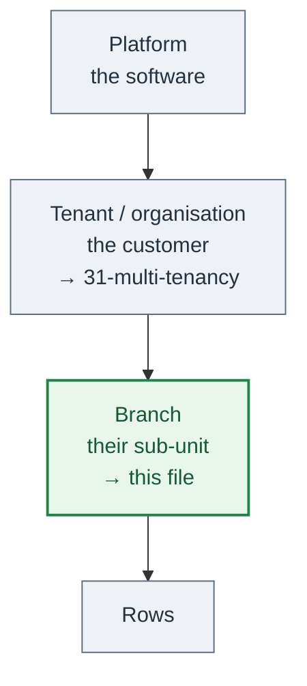

# 08 — Branches: scoping data inside one customer

**Read the first section before anything else in this file. The word "tenant" is used
wrongly more often than it is used rightly, and the wrong reading of it produces a design
that cannot be sold to a second customer.**

Scope the first table, and every table after it. The defects this prevents are data
leaks.

---

## The rules

These are rules, not options. The numbered sections are the working detail behind them.

**B1. One table per entity kind. Never one table per branch.** The table namespace is flat
and account-wide and the table quota is a hard ceiling (§ 2).

**B2. Put the branch in the key, never in the table name.** A table name per branch
multiplies every table, every index and every protection setting.

**B3. Pass the branch to the repository as an argument. Never ambient.** An ambient value
that disappears across an async hop cannot make a missing scope a compile error. Reference A
shipped the ambient version and it leaked repeatedly (§ 4.1).

**B4. A scoped repository never touches the raw store client.** If an operation cannot be
expressed with the base class primitives, extend the base class.

**B5. Never pass a row limit to a post-filtered query** unless the key condition alone
already guarantees at most one row per branch. The limit applies to the wrong set.

**B6. A cross-branch overwrite is a programming error.** Report it as an unexpected failure.
Never translate it into a declared error value
([17-observability-and-errors](17-observability-and-errors.md) § 7).

**B7. Resolve the branch from a verified claim.** A privileged override is honoured only
after the role check that permits it, refuses a branch that does not exist, never falls back
to the caller's own branch, and is named in every answer that used it (§ 5.3).

**B8. Every anonymous endpoint has a registered resolver.** Where none is registered the
provider throws. Never register a fake resolver to silence a stray scoped call.

**B9. A worker reads the branch from the row it is processing. Never default one.**

**B10. Use a generated identifier for a key.** Prefix anything user-chosen or externally
owned with the branch, at the repository boundary (§ 7).

**B11. Never key a scoped table on a bare user identity.** Prefix it anyway.

**B12. A user belongs to exactly one branch.** Working across branches is a membership
grant checked at the request boundary, not a second home branch.

**B13. Every broadcast carries the branch on the envelope, and a payload without one is
dropped loudly.** Suppress the sender's own echo by client instance identifier, never by
user identifier — the same user's other windows need the update (§ 6.1).

**B14. Load every per-branch static asset through one path helper.** A literal path in a
component is a cross-branch leak no repository guard can catch (§ 6.2).

**B15. Global data is a written decision with a one-sentence reason.** In a product with
more than one customer, the same question is answered again at the tenant level, where
the answer is usually no ([31-multi-tenancy](31-multi-tenancy.md) § 5.1).

**B16. Every scoped repository has a cross-branch isolation fixture, and a sentinel fails
the build when one is missing** (§ 8).

---

## 1. A branch is not a tenant

A **branch** is a sub-unit **inside one customer**: a region, a chapter, a depot, a site,
a team. Every branch in the system belongs to the same organisation. They share:

- one commercial relationship — nobody is billed per branch by a third party;
- one brand, one set of domains, one sign-in page;
- one data controller, and one privacy notice;
- one deployment, one database, one release;
- one set of administrators at the top, who can legitimately see every branch.

A **tenant** is a different **customer**: another organisation, with its own contract, its
own brand, its own data controller, and its own right to take its data and leave. Two
tenants' administrators must never be able to see each other, and "the person at the top
can see everything" is the thing that must **not** be true.

| | Branch (this file) | Tenant (**[31-multi-tenancy](31-multi-tenancy.md)**) |
|---|---|---|
| What it is | A sub-unit of one customer | Another customer |
| Top-level administrator | Legitimately sees every branch | Must never see another tenant |
| Brand, domains, sign-in | Shared | Separate per tenant |
| Billing | One contract | One contract **each** |
| Data controller | One | One **each** |
| Offboarding | Delete some rows | Hand over or destroy a whole data set |
| Mechanism | Scope in the key (§ 3) | A topology decision first ([31](31-multi-tenancy.md) § 3) |

**The two nest.** The full shape of a product sold to several customers is:

The mechanism below is the same mechanism at either level, so none of it is wasted. What
differs is everything **around** the rows: identity, brand, domains, billing, limits and
offboarding. That is [31-multi-tenancy](31-multi-tenancy.md), and it is a far bigger
decision than a key prefix.

If the product genuinely has one customer and one branch forever, skip the mechanism but
keep § 7: the primary-key rules apply to any scoped namespace, scoped or not.

---

## 2. Where this runs, and why the scope is in the key

This set assumes a managed cloud key/value store — Reference A uses DynamoDB — in **one
account and one region**. Three properties of that store decide the whole design:

- **Tables are named in one flat, account-wide, region-wide namespace.** There are no
  databases or schemas to nest them in. Two things that want the same table name collide
  at the account level, not inside some container.
- **The account has a quota on the number of tables.** The default is in the low thousands
  and can be raised on request, but it is a real ceiling and it is per account per region.
  Check the current value before any design leans on it.
- **A table is a deployed resource with its own configuration**: its indexes, its capacity,
  its recovery settings, its deletion protection, its backup schedule, its alarms, its
  entry in the infrastructure state.

**Therefore: one table per entity kind, never one table per branch.** Reference A's one
deployment has **137** tables. A table per branch would be 137 × the number of branches,
and each one would need its indexes, its protection settings and its guard tests. At a
few thousand tables the account quota stops the product growing, long before the data
does.

Reference A rejected table-per-branch in its own decision record for exactly that — "AWS
limits and table count explode", plus the cost of fanning an administrative read across N
tables. The alternative it chose is the rest of this file: **the branch is part of the
key**.

Two more consequences worth writing down before you meet them:

- **The infrastructure apply grows with the table count, not with the data.** 137 tables
  is already a slow plan. Adding a dimension that multiplies it is an operational change,
  not just a data-model one.
- **Policies that name tables have a size limit.** A permission document that lists tables
  by name stops fitting. One that names a prefix does not.

---

## 3. The model

- Every branch has an identifier: a short stable slug, not a display name.
- Most domain rows carry a `branchId` attribute and are readable only within their branch.
- Some data is deliberately **global** — shared reference data, a public namespace, a
  cross-branch administrative record. Global is a decision that is written down, not a
  default. In a product with more than one customer the same question is answered again at
  the tenant level, where "shared" means shared across customers and the answer is usually
  no ([31-multi-tenancy](31-multi-tenancy.md) § 5.1).
- **A user belongs to exactly one branch.** Where somebody must work across branches, that
  is a membership grant checked at the request boundary (§ 5.3), not a second home branch.
  Keep it that way: the day a user's branch becomes movable, every table keyed on a bare
  user identity starts colliding (§ 7).

---

## 4. The scoping mechanism

Three parts:

1. **A branch provider** resolved per request. The entrypoint builds it from the request
   context and passes it to the repositories that need it.
2. **A branch-scoped repository base class** that every scoped repository extends. It owns
   the primitives: `save`, `saveNew`, `saveMany`, `findByKey`, `findAllForBranch`,
   `queryForBranch`, `deleteByKey`, `applyTypedUpdate`.
3. **An index on the branch attribute** so "everything for this branch" is a query, not a
   scan.

**A note on the word.** Other files in this set name the ambient-state port
`TenantContext` ([03-backend-domain-and-ports](03-backend-domain-and-ports.md) § 3.3).
Read that as **the scope port**: it carries whichever isolation level the product actually
has. In a product with one customer that is the branch. In a pooled multi-customer product
it carries the customer, and the branch sits below it
([31-multi-tenancy](31-multi-tenancy.md) § 5). The mechanism does not change; the number of
levels does.

### 4.1 Explicit, never ambient

**Every scoped repository method takes the branch context as an argument.** Reference A
tried the other way first — a base repository that read "the current branch" from
async-local storage — and it shipped a series of cross-branch contamination defects
immediately. Every leak was the same shape: a use case that forgot the base helper, used
a different repository, or read by a global key. The abstraction hid the requirement.

The fix was to make forgetting a **compile error**: the branch is a parameter, so a call
site that does not have one does not build. An ambient value that disappears across an
async hop cannot do that.

### 4.2 The base class is the boundary

**A scoped repository never reaches past the base class to the raw store client.** A
direct client call inside a subclass bypasses the enforcement entirely, and nothing in the
type system objects. If an operation cannot be expressed with the primitives, **extend the
base class.** That keeps the enforcement in one reviewable place.

### 4.3 Reads are filtered, and the filter runs where it can

`findAllForBranch` uses the branch index. `queryForBranch` may filter after the store
returns — in which case **any row limit passed into it limits the wrong set**. Never pass
a limit to a post-filtered query unless the key condition alone already guarantees at most
one row per branch.

### 4.4 Writes are guarded

`save` checks the row's existing branch before overwriting. A cross-branch overwrite raises
a distinct ownership-violation error. **That error is a programming error, not a domain
answer:** it is reported, and it reaches the caller as an unexpected failure
([17-observability-and-errors](17-observability-and-errors.md) § 7). It is never translated
into a declared error value, because doing so tells the caller their request was understood
and refused, when in fact the code asked the wrong question.

Where a collision between branches is a *legitimate* outcome rather than a defect — a
user-chosen name in a global namespace — that is a declared error value on the endpoint,
produced by an explicit check before the write, not by catching the guard. See § 7.

Bulk writes need per-item conditions to keep that guarantee. Do not replace a transactional
bulk write with a cheaper unconditional one to save cost; the safety property is the point.

---

## 5. Resolving the branch

| Caller | Source of the branch |
|---|---|
| Authenticated user | A verified claim on the token |
| Privileged user acting elsewhere | A header, honoured **only after** the role check that permits it |
| Anonymous public endpoint | An explicit resolver registered for that endpoint |
| Worker | Read from the row or message being processed |
| Scheduled job | Iterate branches explicitly; never assume one |

### 5.1 Anonymous endpoints need an explicit resolver

An endpoint reachable with no token cannot read a claim. Register a resolver per such
endpoint — from a subdomain, a path segment, or a lookup on the entity being addressed (a
public link's own record knows its branch).

Where no resolver is registered, the entrypoint supplies a provider whose `get()`
**throws**. That is a safety net, not a fallback: an anonymous endpoint that touches only
global data should never call a scoped method anyway. Do not register a fake resolver to
silence a stray scoped call — fix the use case.

### 5.2 Workers derive it from the data

Parse the event, point-read the entity with the raw client, read its branch, wrap it in a
constant branch provider, and construct the scoped repositories. Every worker that touches
scoped data follows this shape. Skipping the lookup and defaulting silently mixes branches.

### 5.3 The privileged cross-branch path is one named thing

An administrator who may act in another branch gets **one** named mechanism that sets the
branch for one request. Rules that keep it from spreading:

- It is resolved **after** the role check that permits it, never before.
- A branch that does not exist is refused. A shape check on the slug is not an existence
  check, and accepting a well-formed unknown slug runs the whole request against a branch
  nobody owns.
- A refusal never falls back to the caller's own branch. Silently answering about the wrong
  branch is worse than an error.
- Every answer that used the override says which branch it ran against.

---

## 6. The surfaces that are scoped by something other than a key

### 6.1 Push and realtime

Every broadcast carries the branch on the envelope. The fan-out reads it and delivers only
to connections in that branch. A payload with no branch is dropped, loudly.

- The connection's branch is fixed at handshake from the token's claim. A privileged user
  browsing another branch over HTTP will **not** receive that branch's pushes.
- Every publish site must have a concrete branch in scope: use cases take it from the
  branch port, workers resolve it from the row. A cross-branch broadcast is a bug.
- **Echo suppression uses the client instance identifier, not the user identifier.** A
  broadcast caused by one client should not be re-applied by that client, which already has
  the change — but the same user may have two tabs or two devices open, and both of those
  do need it. Put the originating instance identifier
  ([03-backend-domain-and-ports](03-backend-domain-and-ports.md) § 3.3.2) on the envelope
  and let each client ignore its own. Suppressing by user identifier drops the update on
  the user's other windows.

### 6.2 Static assets are scoped only by their path

Files served from a public bucket or CDN with no authorization are separated by nothing but
the directory in their URL.

- Load every such file through one helper that resolves the active branch's directory. A
  literal path in a component is a cross-branch leak no repository guard can catch.
- **Anything person-level stays behind the API.** Do not publish it as a static asset; it
  is world-readable to anyone who guesses a directory name.
- A branch may legitimately have no file for a given data source. Declare that in a
  registry and let a per-branch manifest decide whether the feature is offered, rather than
  shipping something that returns a 404 when switched on.

---

## 7. Primary-key shape

**A scoped table whose primary key is a caller-supplied value is broken until you prove
otherwise.** Two branches pick the same value, address the same row, and the second write
hits the ownership guard — which surfaces as an unexpected failure, because that is what an
ownership violation is. The user is told nothing useful, and the one thing that would have
helped — that a different name would work — is the one thing the system cannot say.

**Use a generated identifier.** Everything else on this list is an exception that has to
earn its place, and each one has a condition attached. State in the pull request which line
the key follows:

- [ ] **Generated identifier** — cannot collide. Note it and move on.
- [ ] **User-chosen name or slug** — must be branch-prefixed at the repository boundary.
      Encode on write, decode on read, and keep the caller-facing identifier plain
      everywhere above the repository. Ship a test proving two branches can use the same
      name.
- [ ] **User identity** — **prefix it anyway.** A bare identity key does not collide while
      users belong to exactly one branch, and it starts colliding silently on the day that
      changes. The prefix costs nothing now and removes a whole class of future defect. If
      the identity genuinely follows the person across branches, the table is global and
      must not extend the scoped base class.
- [ ] **Externally-owned identifier** — shared across branches by definition. Must be
      prefixed.
- [ ] **Composite key where a second attribute separates branches** — acceptable, listed
      explicitly in an allowlist, with the reason written down.

### 7.1 Deliberately global namespaces

Some namespaces are global by design: a public short link, a publicly resolvable slug whose
resolver has no branch context. Where that is right:

1. Document the invariant — why global is correct, and what stops one branch reading
   another's data through it.
2. Give the collision its own error value on the affected endpoints — `SlugAlreadyTaken` —
   so the client can tell the user a different name would work. Never let an ownership
   violation reach the client.

**And mark it.** A global slug namespace that is fine across one customer's branches is a
cross-customer collision in a product with more than one customer, and in the worst cases a
cross-customer read ([31-multi-tenancy](31-multi-tenancy.md) § 5.1).

## 8. Tests that enforce isolation

Four, and the first three are cheap:

**1. A cross-branch isolation fixture per scoped repository.** One test walks a fixture
list: create in branch A, read, list, update and delete as branch B, assert nothing leaks.
A **discovery sentinel** in the same test fails the build when a scoped repository has no
fixture — that is what stops the next table being added without a test.

**2. An identity-key sentinel.** Walk the same fixtures, force every caller-identity field
to one value, and fail when a key attribute comes back as that bare identity for a table not
on the documented allowlist. **A failure is a request to prefix the table, not to extend the
allowlist.** Extend the allowlist only when the table is genuinely global, and write the
reason on the entry.

**3. An infrastructure guard.** Assert that every scoped table declared in code has its
branch attribute and its branch index in the infrastructure definitions. Without the index,
`findAllForBranch` throws at runtime in a deployed environment, and neither a typecheck nor
a test against a fake repository sees it.

**4. A leakage end-to-end test** where the feature is user-visible: create in branch A, sign
in as branch B, assert absence in the list, the search, and any client sync payload.

**All four of these test code, and code is where the holes move.** Every barrier in this
file — the request scope, the base class, the key prefix — is a line somebody can change.
That is enough for branches inside one customer, where the top administrator may see all of
it anyway. It is not enough when the boundary is between **customers**: there you need at
least one barrier the application cannot edit its way past.
[31-multi-tenancy](31-multi-tenancy.md) § 2.1 to § 2.3 is that argument, with the diagrams.

If a feature is intentionally global, say so in the design and skip test 4 — but say it, in
writing, in the same pull request.

---

## 9. Mixed-scope features

A feature can legitimately be partly global. Example shape: a public resolver reads by
primary key with no branch context, while the administrative list, update and delete are
branch-scoped; a related table of events is written by the anonymous handler and is not
scoped, because every read of it is gated behind a scoped lookup of its parent.

That is a sound design, and it is also exactly the kind of thing nobody can reconstruct six
months later. **Write the security invariant down** — which reads are gated by what — in a
decision record, in the same pull request.
