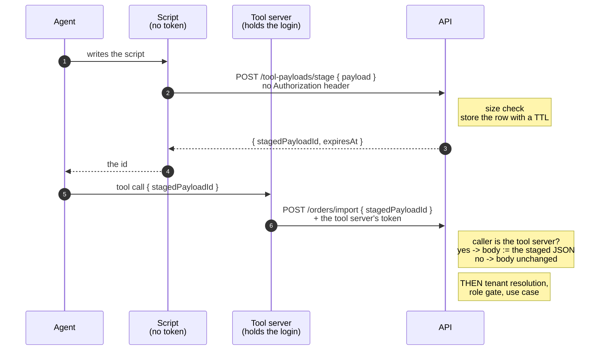
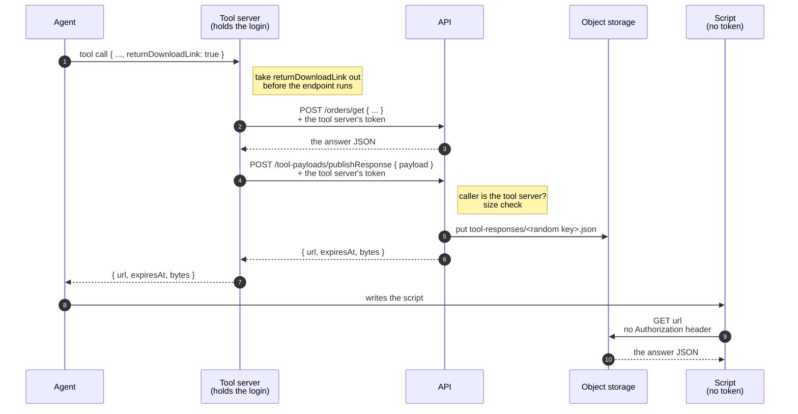

# 26 — Staged payloads and download links for large agent tool calls

An AI agent that calls the API through a tool server (an MCP server, or any tool layer
that turns endpoints into model tools) must write every tool argument token by token,
inside the call. A large body — a map layout, a long document, a bulk import — is slow
to write, fills the conversation, and is easy to truncate. A script on the agent's
machine can build the same JSON at once, but a tool call has no way to take its body
from outside the call.

This file is the pattern that closes that gap: **a script uploads the body to an
anonymous staging endpoint and gets an id back; the tool call sends only the id; the
API dispatcher swaps the id for the staged body, for tool-server callers only.**

The other direction, a large tool *answer*, is § 9: the tool answers a short-lived signed
download URL in place of the JSON.

Reference implementation: Reference A, ADR "Anonymous JSON staging for MCP tool calls".

This file is one pattern of the tool server. The tool server itself — the allowlist, the
context budget, file uploads, the per-login tenant and the whole authorization lifecycle —
is [27-tool-servers-and-mcp](27-tool-servers-and-mcp.md).

---

## 1. The flow



The model writes a short script and one id. The script never needs a token, because the
tool server holds the login, not the script.

---

## 2. The staging endpoint

An ordinary use case behind an ordinary RPC path
([04-use-cases](04-use-cases.md), [06-api-contract-and-codegen](06-api-contract-and-codegen.md)):

```ts
@ApiEndpoint({ namespace: 'toolPayloads', method: 'stage', roles: ['Anonymous'], personalData: false })
export class StageToolPayloadUseCase {
  constructor(
    private readonly repository: StagedToolPayloadRepository,
    private readonly clock: Clock,
    private readonly newId: () => string = randomUUID,
  ) {}

  async execute(request: StageToolPayloadRequest): Promise<StageToolPayloadResponse> {
    const payload = request?.payload;
    if (typeof payload !== 'object' || payload === null || Array.isArray(payload)) {
      throw new ValidationError('`payload` must be a JSON object.');
    }
    const payloadJson = JSON.stringify(payload);
    if (Buffer.byteLength(payloadJson, 'utf8') > MAX_STAGED_PAYLOAD_BYTES) {
      throw new ValidationError(`\`payload\` is larger than ${MAX_STAGED_PAYLOAD_BYTES} bytes.`);
    }
    const stagedPayloadId = this.newId();
    const now = this.clock.now();
    const expiresAt = new Date(now.getTime() + STAGED_PAYLOAD_LIFETIME_MS).toISOString();
    await this.repository.save({ stagedPayloadId, payloadJson, createdAt: now.toISOString(), expiresAt });
    return { stagedPayloadId, expiresAt };
  }
}
```

Rules:

- **Request:** `{ "payload": <the tool arguments object> }`. The payload must be a JSON
  object, because a tool body is an object.
- **Response:** `{ stagedPayloadId, expiresAt }` and nothing else. **No endpoint ever
  reads a staged payload back.** Without a read path, a leaked id lets someone *use* a
  body, never *read* one, and the endpoint can be classified as returning no personal
  data.
- **The id is made on the server**, from a random UUID (122 random bits). Never accept a
  caller-chosen id: that turns the table into a namespace someone can squat or overwrite.
- **Size is counted in UTF-8 bytes, not characters.** The cap sits below the store's item
  limit with room for the other attributes (Reference A: 400,000 bytes against a 400 KB
  item).
- **Write with a not-exists condition on the key**, so a collision fails instead of
  replacing a row.
- **Do not log the payload.** It is the caller's tool body and can hold anything.

### 2.1 The table

- **Global, not tenant-scoped.** The upload is anonymous, so there is no tenant to scope
  by, and the key is a server-made UUID. Write this down as the global-data exception
  ([08-branches-and-data-scoping](08-branches-and-data-scoping.md) § 3).
- **Short lifetime.** Reference A: ten minutes. Long enough for a retry, short enough
  that the table holds almost nothing.
- **The store's TTL is the only delete**, and TTL is lazy (DynamoDB can delete up to two
  days late). **The reader checks `expiresAt` on every read.** Never treat "the row
  exists" as "the row is valid".
- **No point-in-time recovery and no backup export** for this table. Every row is gone
  within minutes, so a restore has nothing to give back, and a backup keeps a copy of
  every payload for weeks. Pin this with a guard test
  ([12-testing-integration-and-guards](12-testing-integration-and-guards.md)).

---

## 3. The swap, in the dispatcher

The swap is one function, called right after the entrypoint parses the body and **before
anything else reads the body** — before tenant resolvers, before the role gate, before
the use case. Every later step then sees the staged JSON as if the tool server had sent
it, so no use case knows the pattern exists.

```ts
export const STAGED_PAYLOAD_ID_FIELD = 'stagedPayloadId';
const UUID_PATTERN = /^[0-9a-f]{8}-[0-9a-f]{4}-[0-9a-f]{4}-[0-9a-f]{4}-[0-9a-f]{12}$/;
const NOT_FOUND = 'The staged payload does not exist or has expired. Stage it again.';

export async function swapStagedPayload(
  body: Record<string, unknown>,
  isToolServerCaller: boolean,
  repository: StagedToolPayloadRepository,
  nowIso: string,
): Promise<Record<string, unknown>> {
  if (!isToolServerCaller || !(STAGED_PAYLOAD_ID_FIELD in body)) return body;
  if (Object.keys(body).length > 1) {
    throw new ValidationError('A body with `stagedPayloadId` must have no other field.');
  }
  const id = body[STAGED_PAYLOAD_ID_FIELD];
  if (typeof id !== 'string' || id.length === 0) {
    throw new ValidationError('`stagedPayloadId` must be a non-empty string.');
  }
  if (!UUID_PATTERN.test(id)) throw new NotFoundError(NOT_FOUND);

  const staged = await repository.findById(id);
  if (!staged || Date.parse(staged.expiresAt) <= Date.parse(nowIso)) {
    throw new NotFoundError(NOT_FOUND);
  }
  return JSON.parse(staged.payloadJson) as Record<string, unknown>;
}
```

```ts
// entrypoint, straight after parsing
const payload = await swapStagedPayload(
  parseJsonObject(event.body),
  Boolean(TOOL_SERVER_AUDIENCE) && caller.audience === TOOL_SERVER_AUDIENCE,
  stagedPayloadRepository,
  clock.nowIso(),
);
```

Rules:

- **Only the tool server's callers get the swap.** Decide it from a verified token claim
  (Reference A: the token's audience is the tool server's client id). For a web or mobile
  token the body is unchanged, so the id reaches the use case as an unknown field and the
  new data path never reaches the apps. Guard the empty-configuration case: an unset
  audience must mean "nobody", never "everybody".
- **A body with the id and any other field is a 400.** Mixing is ambiguous — which wins? —
  so refuse it. The one exception is a tenant selector the tool server adds outside the
  body (§ 3.1).
- **Unknown, malformed or expired id → 404** with one message that tells the agent what to
  do: stage it again. Do not tell the caller *which* of the three it was.
- **Check the id's shape before the read.** A string that cannot be a server-made id names
  no row. Without the check, a 3 KB id reaches the store, the store refuses the key with a
  validation exception, and that reports as a server fault.
- **The id is reusable until it expires and is not bound to a caller.** A failed tool call
  can be retried with the same id. The cost is § 5.
- **The swapped body runs under the second caller's roles.** The role gate runs after the
  swap, against the token that sent the id, not anything about who staged it.

### 3.1 The tenant stays outside the staged body

The tenant comes from the token, or from the tool server's own tenant argument, never from
inside the staged JSON. A staged body that names another tenant cannot move a write there.
Prove that with an end-to-end test (§ 7) — it is the cross-tenant test
[08-branches-and-data-scoping](08-branches-and-data-scoping.md) § 8 requires, applied to the new path.

---

## 4. The tool schema

The tool server publishes one tool per endpoint from the generated contract manifest
([06-api-contract-and-codegen](06-api-contract-and-codegen.md)). For every tool that takes
a body, it adds an optional `stagedPayloadId` property:

```ts
export function withStagedPayloadIdProperty(schema: JsonSchema): JsonSchema {
  if (schema.properties && STAGED_PAYLOAD_ID_PROPERTY in schema.properties) {
    throw new Error(`Endpoint schema already declares "${STAGED_PAYLOAD_ID_PROPERTY}".`);
  }
  const { required, ...rest } = schema;
  return {
    ...rest,
    properties: { ...(schema.properties ?? {}), [STAGED_PAYLOAD_ID_PROPERTY]: { type: 'string' } },
    ...(required && required.length > 0
      ? { anyOf: [{ required }, { required: [STAGED_PAYLOAD_ID_PROPERTY] }] }
      : {}),
  };
}
```

- **The endpoint's `required` list moves into an `anyOf`.** Without that, a call with only
  the id fails the client's schema check before it is sent.
- **Refuse a schema that already declares the property.** The staged argument would shadow
  a real field.
- **No description on the property.** With hundreds of tools, a description repeats in
  every tool definition and costs context on every turn. Explain it **once**, in the tool
  server's instructions, built from the configured API base URL so each environment names
  its own staging URL:

  > Large tool arguments: a tool call whose arguments are too large to write in the call
  > can send `{ "stagedPayloadId": "<id>" }` in place of every other argument. To get the
  > id, a script sends `POST <api>/tool-payloads/stage` with the JSON body
  > `{ "payload": <the tool arguments object> }` and no Authorization header. The answer is
  > `{ "stagedPayloadId": "<id>", "expiresAt": "<ISO time>" }`. The payload is at most
  > 400,000 bytes of JSON. The id can be used again for 10 minutes, then answers 404. One
  > IP address can stage 20 payloads in 5 minutes.

- **Tools with no body do not get the property.**
- **A hand-written tool that replaces a generated one does not get it automatically.**
  Add it by hand or accept the gap, and say which.

---

## 5. Cost ceilings

An anonymous write is paid for by the platform. Put a ceiling on each axis, and write the
worst-case monthly number in the decision record
([19-performance-and-scale](19-performance-and-scale.md) § 9).

| Axis | Control | Reference A |
|---|---|---|
| Bytes per call | Size check in the use case | 400,000 bytes |
| Calls per IP | Edge rate rule scoped to the stage path, ordered before the general anonymous rule so it counts first; answers 429 | 20 per 5 minutes |
| All IPs together | Table-level write throughput cap | 400 write units/s |

The per-IP rule does not stop many addresses together. The table cap does: above it the
store refuses the write, so the bill cannot pass `cap × seconds in a month × unit price`.
The price of the cap is that staging fails during such an attack. Normal tool calls are
unaffected, because they do not need staging.

Reference A's numbers: normal use (1,000 payloads a month) is about £0.45; one IP at its
limit for a month is about £76; the table cap bounds all IPs together at about £577.

---

## 6. Options rejected

| Option | Why not |
|---|---|
| Swap for every caller | Opens a second body path for web and mobile clients that nothing needs, and widens the attack surface of an anonymous write. |
| Swap in the tool server (read back, then send) | Needs a read-back endpoint, which turns a leaked id into a data leak. Needs one change per tool-server transport (local and hosted) instead of one in the API. |
| Authenticated staging | The script would need a token, and the token lives in the tool server. Handing it to a script is the thing the pattern exists to avoid. |
| Object storage with a presigned upload URL | Works, but needs a tool call to get the URL first, a second store to clean up, and the same swap anyway. Prefer it only when payloads must pass the item-size limit. |

---

## 7. Tests

Use-case and service tests use in-memory fakes ([11-testing-unit](11-testing-unit.md)):

**Stage use case**
- needs no role;
- stores the payload as JSON text and answers the id and the expiry;
- makes a random UUID by default;
- accepts a payload of exactly the size limit;
- refuses a payload one byte over, and stores nothing;
- counts the size in UTF-8 bytes, not characters (a multi-byte character at the limit);
- refuses a request with no body, and a payload that is an array, a string or null.

**Swap**
- replaces a tool-server body that holds only the id with the staged JSON;
- lets the same id be used again before it expires;
- returns the body unchanged for a caller that is not the tool server;
- returns a tool-server body with no id unchanged;
- refuses an id sent with any other field;
- answers not-found for an unknown id, and for a malformed id without reading the store;
- answers not-found **at** the expiry time, while the row is still in the table.

**Tool schema**
- adds the property and moves `required` into an `anyOf`;
- adds no `anyOf` when the endpoint requires nothing;
- refuses a schema that already declares the property;
- keeps the tenant argument addable on top;
- publishes the property on a body tool, and on a tool whose request is a schema reference;
- does not publish it on a tool with no body;
- the instructions name the staging URL on the configured API, the body shape and the limits.

**End to end**, against the real API and the real tool-server token
([13-testing-e2e](13-testing-e2e.md)):
- a script stages a body with no token, and a tool call uses the id twice, once with the
  tenant argument;
- an unknown or expired id answers 404 with the message; a mixed body answers 400;
- the stage endpoint refuses a non-object body and a payload over the limit;
- a staged body cannot move a write into another tenant: the token picks the tenant;
- a web app token gets no swap: the id reaches the use case as an unknown field.

**Guards**: the table has a TTL attribute and no point-in-time recovery; the edge rule
exists, is scoped to the stage path, and is ordered before the general anonymous rule; a
guard test pins the list of endpoints that accept no token, and the stage endpoint is on
it ([18-security-and-privacy](18-security-and-privacy.md) § 2).

---

## 8. Swap points

- **Store:** any key/value store with TTL, or a relational table with an `expires_at`
  column and a scheduled delete. The read-time expiry check stays either way.
- **Edge limiter:** any rate limiter keyed on client IP and scoped to the path.
- **Tool protocol:** MCP or any other. The swap lives in the API, so the tool layer only
  publishes the property and the instructions.
- **Lifetime and size:** tune them, and put the new worst-case cost in the decision record.

**Not swap points:** server-made ids, no read-back endpoint, the swap only for the tool
server's audience, the swap before tenant resolution and the role gate, the expiry check on
read, and a ceiling on every cost axis.

---

## 9. The other direction: a large answer as a download link

Staging moves a large body *into* a tool call. A large *answer* has the same problem in
the other direction: a tool that reads a layout or a long document returns it inline, and
the JSON fills the conversation. An edit of a large entity needs both directions.

The pattern: **every tool takes an optional `returnDownloadLink: true`. The tool server
stores the final answer through an authenticated publish endpoint, the API puts the JSON
in object storage under a random key, and the tool answers a short-lived signed GET URL in
place of the JSON. A script downloads the URL with no token.**

Reference implementation: Reference A, ADR "An MCP tool can answer a short-lived download
URL".



### 9.1 The publish endpoint

```ts
@ApiEndpoint({ namespace: 'toolPayloads', method: 'publishResponse', roles: ['Editor'], personalData: false })
export class PublishToolResponseUseCase {
  constructor(
    private readonly fileStore: Pick<FileStore, 'putFile' | 'getDownloadSignedUrl'>,
    private readonly toolServerAudience: string | null,
    private readonly newKey: () => string = () => randomBytes(16).toString('hex'),
  ) {}

  async execute(request: PublishToolResponseRequest, context: RequestContext): Promise<PublishToolResponseResponse> {
    if (!this.toolServerAudience || context.audience !== this.toolServerAudience) {
      throw new ForbiddenError('Only the tool server can publish a tool answer.');
    }
    if (request?.payload === undefined) throw new ValidationError('`payload` is required.');

    const payloadJson = JSON.stringify(request.payload);
    const bytes = Buffer.byteLength(payloadJson, 'utf8');
    if (bytes > MAX_TOOL_RESPONSE_BYTES) {
      throw new ValidationError(
        `The answer is ${bytes} bytes, larger than ${MAX_TOOL_RESPONSE_BYTES} bytes. Narrow the call and try again.`,
      );
    }
    const key = `${TOOL_RESPONSE_KEY_PREFIX}${this.newKey()}.json`;
    await this.fileStore.putFile(key, Buffer.from(payloadJson, 'utf8'), 'application/json');
    const url = await this.fileStore.getDownloadSignedUrl(key, TOOL_RESPONSE_URL_LIFETIME_SECONDS);
    const expiresAt = new Date(Date.parse(context.nowIso) + TOOL_RESPONSE_URL_LIFETIME_SECONDS * 1000).toISOString();
    return { url, expiresAt, bytes };
  }
}
```

Rules:

- **The endpoint needs a login, and only the tool server's audience may call it.** The
  role gate alone is not enough: a web or mobile token passes it, and the endpoint would
  then turn any JSON into a URL that needs no token. Check the verified audience claim in
  the use case and answer 403 for every other caller. An unset audience must refuse
  everybody, as in § 3.
- **The script needs no token.** The login lives in the tool server. The signature in the
  URL is the only credential the script holds.
- **The key is made on the server**, from 16 bytes of the operating system's secure random
  source (128 bits), under a prefix that holds nothing else. Never build the key from
  caller input.
- **The URL is short-lived and reusable.** Reference A: 600 seconds. The script can fetch
  it more than once inside that window, so a failed download can retry.
- **Answer `{ url, expiresAt, bytes }` and nothing else.** `bytes` lets the agent decide
  how to read the file before it downloads it.
- **Size is counted in UTF-8 bytes.** Set the answer limit to the stage limit, so an entity
  that can be downloaded can be staged back after an edit. Keep the limit below the
  function's request body limit (Reference A: 5,000,000 bytes against a 6 MB body limit).
  The refusal message tells the agent what to do: narrow the call.
- **An object-storage lifecycle rule is the only delete.** Reference A: the prefix expires
  after one day. The URL stops working long before that; the rule only stops the bill.
- **Do not log the payload**, and do not write an audit event for a publish. The answer
  is a copy of data the caller has already read.
- **Personal data:** the endpoint stores only what the caller sends. Classify it as
  returning no personal data only when the tool server's allowlist holds no endpoint that
  returns personal data, and pin that with a guard test
  ([18-security-and-privacy](18-security-and-privacy.md) § 2). If the allowlist holds such
  an endpoint, classify the publish endpoint as personal data too.
- **Put the endpoint on the tool server's allowlist**
  ([27-tool-servers-and-mcp](27-tool-servers-and-mcp.md)). The dispatcher calls it, not the
  model, but the API refuses a tool-server token on an endpoint that is not on the list.

### 9.2 The dispatcher in the tool server

```ts
const { returnDownloadLink, rest: args } = splitReturnDownloadLink(request.params.arguments ?? {});
// ...run the passthrough or the derived tool with `args`...
const text = JSON.stringify(returnDownloadLink ? await publishToolAnswer(api, result) : result, null, 2);
```

Rules:

- **Take the argument out first, for every tool**, before any endpoint or handler sees it.
  This includes derived tools and tenant tools. A value that is not a boolean is a tool
  error, and no API call runs.
- **Publish once, with the final result.** A derived tool that makes four inner calls
  answers one URL for its shaped result, not one URL for each inner call.
- **A failed call answers its error, never a URL.**
- **A publish that fails after the call ran says that the call ran.** Reference A:
  "The call ran, but its answer could not be made into a download link". For a write,
  the agent must not retry a write that already happened.
- **Check the size in the tool server too**, before the publish call. An answer over the
  limit then never leaves the tool server, and the error comes back without a round trip.
- **A result of `undefined` is stored as JSON `null`.**
- **Notes the tool server adds to every answer stay** (Reference A: the active-branch
  note). They go in the tool text next to the link, not inside the stored JSON.

### 9.3 The tool schema

```ts
export function withReturnDownloadLinkProperty(schema: JsonSchema): JsonSchema {
  if (schema.properties && RETURN_DOWNLOAD_LINK_PROPERTY in schema.properties) {
    throw new Error(`Tool schema already declares "${RETURN_DOWNLOAD_LINK_PROPERTY}".`);
  }
  return {
    ...schema,
    properties: { ...(schema.properties ?? {}), [RETURN_DOWNLOAD_LINK_PROPERTY]: { type: 'boolean' } },
  };
}
```

- **Every tool gets the property**, including tools with no body and hand-written tools.
  This is different from `stagedPayloadId`: any tool can answer a large result. Do not
  keep a list of "large answer" endpoints; the list drifts.
- **The property is optional and changes no `required` list.**
- **Refuse a schema that already declares the property.**
- **No description on the property.** Explain it once, in the tool server's instructions:

  > Large answers: every tool takes an optional `"returnDownloadLink": true` argument.
  > With it the tool answers `{ "url": "<URL>", "expiresAt": "<ISO time>", "bytes": <size> }`
  > in place of its JSON. A script downloads the JSON with a plain GET of the URL and no
  > Authorization header. The URL works for 10 minutes and can be fetched more than once.
  > The answer is at most 5,000,000 bytes of JSON. A call without the argument answers
  > inline, whatever its size. A failed call answers its error, never a URL.

### 9.4 The edit loop

The two directions together let an agent edit a large entity without the JSON in the
conversation:

1. Call the read tool with `"returnDownloadLink": true`, and download the URL to a file.
2. Edit the file on disk with a script. Keep every field the update tool needs.
3. Stage the edited JSON (§ 2).
4. Call the update tool with only `stagedPayloadId`, and the tenant argument if needed.

Put this loop in the tool server's instructions, after the two paragraphs above.

**A tool that replaces a whole large entity can require the loop.** Its published schema
accepts `stagedPayloadId` and nothing else, apart from the tenant argument and
`returnDownloadLink`. The caller already sends the whole body for such a tool, so the
round trip costs nothing extra, and it stops the model writing the body into the
conversation. Keep the list of such tools in the tool server, and fail the build when the
list names a tool that is not on the allowlist or has no body. A small write stays inline.

### 9.5 Cost and risk

- **Cost follows real use**, because the publish endpoint needs a login. Reference A:
  1,000 answers a month cost under £0.10. No anonymous ceiling is needed.
- **Anyone who has the URL can download the answer until it expires.** The URL goes only
  to the caller's own tool-server session. Keep the lifetime short.
- **The object stays in the bucket until the lifecycle rule runs**, up to a day after the
  URL stops working.

### 9.6 Options rejected

| Option | Why not |
|---|---|
| The argument on chosen endpoints only | The list of large-answer endpoints is a guess and drifts. Every tool costs one boolean. |
| An anonymous read-back endpoint keyed by an id | A leaked id becomes a data leak, and the endpoint is one more anonymous cost axis. A signed URL lets the object store do the read. |
| A read endpoint that takes the tool server's token | The script would need the token. Handing it to a script is the thing the pattern exists to avoid. |
| Paging the answer inline | The JSON still passes through the conversation, page by page. |

### 9.7 Tests

**Publish use case**
- needs a login with the allowed roles;
- refuses a caller that is not the tool server's audience with 403, and refuses every
  caller when no audience is configured;
- stores the JSON under the random key and answers a signed URL with the configured
  lifetime;
- answers `expiresAt` one lifetime after the request time;
- counts the size in UTF-8 bytes, not characters;
- accepts an answer of exactly the size limit; refuses one byte over, and stores nothing;
- makes a new key for each call, from 16 secure random bytes.

**Dispatcher and schema**
- adds an optional boolean and keeps the rest of the schema; adds it to a schema with no
  properties; refuses a schema that already declares it;
- answers `false` and the same arguments when the property is absent; refuses a value
  that is not a boolean, and calls nothing;
- posts the result as the payload and answers the link; stores `undefined` as `null`;
- sends an answer of exactly the limit; refuses one byte over and sends nothing; counts
  UTF-8 bytes;
- wraps a publish refusal in a message that says the call ran.

**End to end**, against the real API, the real object store and the real tool-server token
([13-testing-e2e](13-testing-e2e.md)):
- a passthrough answer comes back as a URL that a plain GET with no token downloads;
- the URL can be fetched twice, and stops working after its lifetime;
- an answer over the limit is a tool error that says to narrow the call;
- the publish endpoint stores exactly the limit and refuses one byte more;
- a derived tool answers one URL for its shaped result;
- the tool server's notes are still shown;
- download, edit, stage, update: a large entity is edited without its JSON in the
  conversation;
- an unknown key does not download;
- a non-boolean argument is a tool error, and nothing is called;
- a failed call answers the error, not a URL;
- the publish endpoint refuses an anonymous call and a web app token.

**Guards**: the lifecycle rule exists for the prefix; the publish endpoint is on the
allowlist; the allowlist holds no endpoint that returns personal data.

---

## 10. Adopting it

1. Write the decision record ([20-decision-records](20-decision-records.md)) with the
   worst-case cost numbers.
2. Add the table in IaC: global, UUID key, TTL, write cap, no point-in-time recovery.
3. Add the repository port, its in-memory fake and its real-store implementation.
4. Add the stage use case: anonymous role, no personal data.
5. Add the swap function, and call it in the entrypoint straight after body parsing.
6. Add the edge rate rule ahead of the general anonymous rule.
7. In the tool server, add the property to every body tool and the paragraph to the
   instructions.
8. Write the tests in § 7, and see each one fail once for the right reason.
9. For large answers: add the publish use case (§ 9.1), the lifecycle rule on its prefix,
   and the allowlist entry.
10. In the tool server, add `returnDownloadLink` to every tool, the dispatcher step (§ 9.2)
    and the instructions paragraphs (§ 9.3, § 9.4).
11. Write the tests in § 9.7, and see each one fail once for the right reason.
