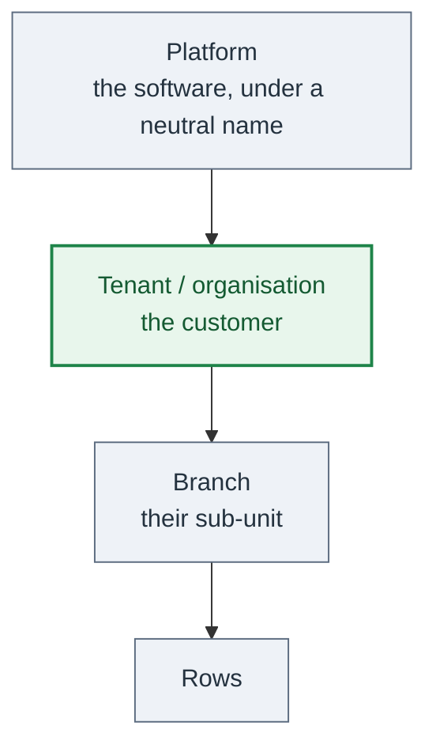
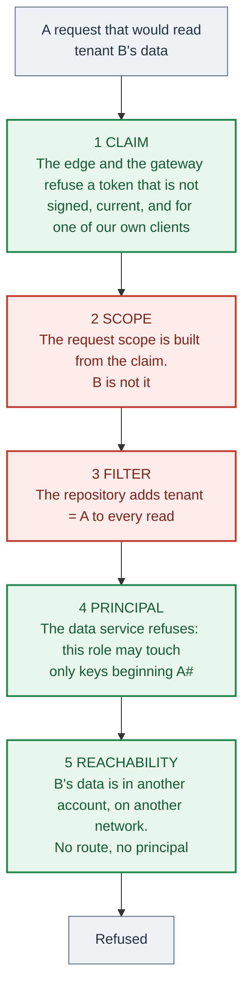
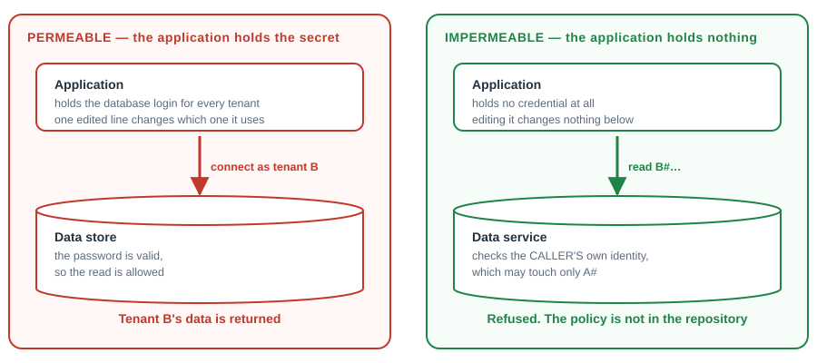
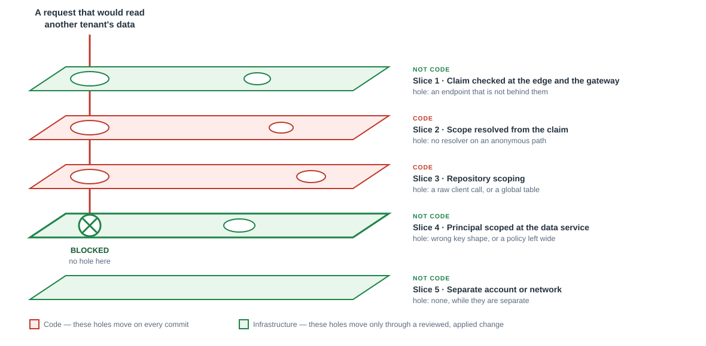
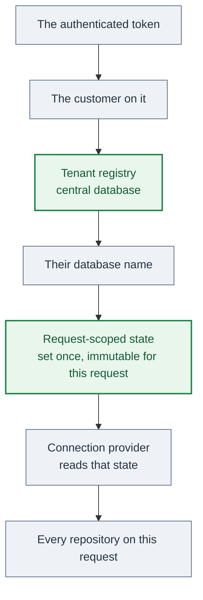

# 31 — Multi-tenancy: separate customers

A **tenant** is another **customer**. Its own contract, its own brand, its own
administrators, its own data controller, its own right to take its data and leave.

A sub-unit inside one customer — a region, a chapter, a depot, a team — is a **branch**, and
it is [08-branches-and-data-scoping](08-branches-and-data-scoping.md).

**The test: if the person at the top may legitimately see all of it, it is branches. If they
must not, it is tenants.**

Reference B (C#, relational) has run store-per-tenant in production for years. Reference A
(TypeScript, key/value cloud store) has branches and a written plan for the tenant level
above them.

---

## 1. The rules

These are rules, not options. The sections after § 1 are the working detail behind them.

### Naming

**R1. Never put a customer's name in a table, bucket, queue, topic, role, domain, prefix or
any other resource name.** Renaming a deployed resource is a data migration.

**R2. Give the platform a neutral name and a neutral domain on day one.** The first
customer's brand on the platform's own domain is R1 with a longer tail.

### Keys

**R3. Put the tenant first in every key.** Every barrier in § 2.2 depends on it. Get this
wrong and the strongest barrier is not available to you at all.

**R4. Never give a user-chosen value a globally unique key.** Prefix it with the tenant. Two
customers will choose the same slug.

**R5. Never key a table on a bare user identity.** Prefix it. It does not collide until the
day it does, and then it does so silently.

**R6. Re-decide every key shape at the tenant boundary.** A key that was unique across one
customer's branches is not unique across customers.

### Topology

**R7. Start with silo — one deployment per customer.** Nothing shared means nothing to leak.
Leave only when the per-customer fixed cost or the per-customer release expectation hurts.

**R8. On a relational store, never pool. Give each customer a database.** It is the normal
answer there, and it makes offboarding a database hand-over.

**R9. Never ship pooled mode with barriers that are all code.** See R12.

**R10. Never put a protocol-adapter data store in production.** Run it as the local and test
store, where a gap costs nothing (§ 3.1).

**R11. Never create a table, or a set of tables, per customer on a key/value cloud store.**
The table namespace is flat and account-wide, and the table quota is a hard ceiling (§ 3).

### Barriers

**R12. Every deployment has at least one barrier that is not code.** Scope the application's
own role to the tenant's key prefix, or put the customer in a separate account.

**R13. Never let the application hold a credential that can reach another tenant's data.** A
secret the process holds does not stop the process.

**R14. Never let the application fetch a credential for a tenant other than the one on the
request.** That is R13 one step removed.

**R15. Enforce the token at the edge and at the gateway, before any handler runs.** A token
checked only inside the application is not checked on the path that forgot to check it.

**R16. Never hand-roll authentication.** Managed identity service, its hosted sign-in page,
its tokens. No password storage, no session table, no token signing, no sign-in form of your
own ([18-security-and-privacy](18-security-and-privacy.md) § 1).

**R17. Resolve the tenant from the verified claim and from nothing else.** Not a host, not a
header, not a body field. A host may choose which sign-in page to show; it grants nothing.

### Data

**R18. Never share a table, a list or a namespace across customers.** § 5.1 is the list of
shapes that look harmless and are not.

**R19. A table is global only when the platform owns the data and no customer can write it.**
A country list, a unit table, a public reference set. Write the reason on the table. If the
reason needs more than one sentence, it is not global.

**R20. Split the top-level role before anything trusts it.** Platform operator crosses
customers and is audited. Tenant administrator crosses that customer's branches and nothing
else.

**R21. Never let a use case depend on the cross-tenant override.** One named type can switch
customers, background work uses it, and a guard test fails on any use case that takes it
(§ 4.3).

**R22. Never default a job, a worker or a migration to one customer.** Enumerate the registry
and iterate. A silent default is work that silently did not happen for everyone else.

### Brand

**R23. Never write a brand literal in source.** One schema-validated configuration object per
customer, in version control, and a guard test that fails the build on any brand word,
domain or sender name outside it.

**R24. Never ship a fallback brand value.** A missing configuration value is a start failure.
A fallback means a misconfigured deployment serves the wrong customer's name instead of
refusing to start.

**R25. Build one neutral mobile application that picks the customer.** A per-customer store
listing costs a review, signing keys, metadata and a release process, on every release,
forever. Take it only when a customer contractually requires its own.

### Lifecycle

**R26. Provision from a pool of pre-created, pre-migrated, unattached stores.** Creating and
migrating during sign-up is visible to the user.

**R27. Name a customer's store randomly, never from the customer's name.** A derived name
leaks the customer list and strands you when a customer is renamed.

**R28. A deploy is not finished until every customer's store is migrated.** The runner is
re-runnable, reports per customer, and does not stop the rest on one failure.

**R29. Suspended means read-only, on one flag, with the data untouched and sign-in working.**
Hiding data or refusing sign-in turns a billing problem into an accusation of holding data
hostage.

**R30. Write the deletion list when the feature is built, not when the request arrives.**
Every store, file prefix, backup, search index and registry row. Test it.

---

## 2. Why R12 to R14: which barriers hold

One question ranks every barrier: **can the running application get past it by changing its
own code?**

Red is code the application can change. Green is enforced outside the application.

| Barrier | Enforced by | Defeated by | Survives a developer deliberately editing the application? |
|---|---|---|---|
| A tenant condition written into a query | That line of code | Deleting the line | **No** |
| A scoped repository base class | The base class and the type system | Calling the raw client instead | **No** |
| One database login that can reach every tenant | Nothing. The process holds it | Changing one string | **No** |
| A per-tenant database login the process can fetch for any tenant | The process asking for the right one | Asking for another tenant's | **No** |
| **The compute's own identity, scoped at the data service** — a condition on the leading key, a prefix-scoped storage policy, a role per tenant | The data service, against the caller's principal | Obtaining a different principal | **Yes** |
| **A separate account or network** | There is no route and no principal | An infrastructure change | **Yes** |

### 2.1 A secret the application holds is not a barrier against the application (R13, R14)

**If the running code can obtain the credential, the credential does not stop the running
code.**

A database username and password in the configuration is reachable by every line of code in
that process. Fetching a per-tenant credential at request time is the same thing one step
removed: if the process can ask for any tenant's credential, the barrier is again "the code
asked for the right one".

### 2.2 How to satisfy R12

Take the first of these that your key shape allows:

1. **Scope the compute's role by key prefix** — a condition on the leading key value, so the
   role may address only items whose key begins with the tenant. One policy, no new
   infrastructure. **Reach for this one.**
2. **Scope object storage by prefix**, so files are separated by a policy and not only by a
   path ([08-branches-and-data-scoping](08-branches-and-data-scoping.md) § 6.2).
3. **Derive a scoped-down session from the caller's own verified token**, so the credentials
   that exist during that request cannot address another tenant at all.
4. **A role per tenant**, assumed from the verified claim. Take this when the data service
   has no key-prefix condition.
5. **A separate account per tenant** (silo), where there is nothing to scope because there is
   nothing shared.

Options 1 to 4 need the tenant to be the leading part of the key. That is R3.

### 2.3 Swiss cheese: which slices are code

Each barrier is a slice with a known hole. A breach needs the holes to line up. What matters
is which slices are code, because code holes move on every commit.

Slices 2 and 3 are code: one merged pull request can open a hole in either, and the guard
tests of § 9 are the only thing watching. Slices 1, 4 and 5 move only when infrastructure
changes — a separate file, a separate review, an applied plan, an audit record
([15-infrastructure-and-environments](15-infrastructure-and-environments.md)).

> **With slice 4 or slice 5 in place, a developer who deliberately edits the application to
> read another tenant's data does not succeed by editing the application.** The data service
> refuses the principal. To succeed they must change the infrastructure — a reviewed, applied
> and audited change — or obtain a different identity.

The limit of that claim, so the claim stays worth making: **someone who can change the
infrastructure and get it applied can still do it.** Keep that change visible, reviewed and
recorded, and keep the deploy role separate from the role the application runs as
([28-supply-chain-and-build-inputs](28-supply-chain-and-build-inputs.md) § 7).

---

## 3. Why R11: what the cloud store imposes

This set assumes a managed cloud key/value store — Reference A uses DynamoDB. Three of its
properties decide which topologies exist at all:

- **Table names live in one flat namespace per account and region.** No databases, no
  schemas. "The same table name for each customer" is not expressible.
- **The account has a quota on tables**, in the low thousands by default and raisable on
  request. Check the current number; never design against a remembered one.
- **A table is a deployed resource** with its own indexes, protection settings, backups,
  alarms and entry in the infrastructure state.

Reference A's one deployment has **137 tables**. So:

| Idea | What happens |
|---|---|
| A table set per customer | 137 × customers. The quota stops the product in the low tens, and every infrastructure apply grows with it |
| A tenant prefix on every table name | A rename of all 137 tables, and the quota problem is unchanged |
| **A tenant attribute in the key** | No new tables, ever. This is why pooled is the default on a key/value store |
| A separate account per customer | Silo (R7). Works, and the fixed cost repeats per customer |

Two things bite before the quota does: an infrastructure plan over thousands of tables is
slow enough to change how the team works, and a permission document that lists tables by
name stops fitting the size limit. One that names a **prefix** does not.

### 3.1 Why R10: store-per-tenant on a key/value store

A wire-compatible adapter — a server speaking the same protocol, storing the data in a
relational database — gives each customer a database without changing a line of repository
code: only the endpoint and credentials differ, and the table names stay as they are.

**Gained:** physical isolation with no table rename; a customer can hold its own database,
even on its own infrastructure; offboarding is a hand-over; a missing tenant filter cannot
read another customer.

**Paid:** servers and a database to run, patch, back up and monitor, where there were none;
compute inside a private network, which puts every other outbound call behind a gateway;
static credentials in a secret store instead of a role; per-customer fixed cost while idle;
the managed store's recovery and export features replaced by the database's.

**Where it earns its place today:** as the local and test store, in place of the usual
lightweight emulator, where it runs the same code path as production and a gap costs nothing
([14-local-dev-and-simulators](14-local-dev-and-simulators.md)). Before anything else depends
on it, confirm that one such server gives each account its own table namespace, and how far
its feature coverage really goes.

---

## 4. Store-per-tenant, in full (R8, R21, R26, R27, R28)

Reference B, in production. Read it even for a pooled design: § 4.5 and § 4.6 are needed
either way.

### 4.1 Two kinds of database

| Central (one) | Per customer (one each) |
|---|---|
| The tenant registry: each customer, and **the name of their database** | Every domain table |
| Users, and which customer they belong to | The customer's own data, and nothing else |
| Platform administrators, and the platform audit log | |
| Billing: payments, subscriptions, payment-provider events | |
| Quotas and allowances: storage, usage units, limits | |
| Sign-in artifacts that must work before a customer is known: temporary tokens, OAuth records | |

**The central database holds what the platform owns, and what must be readable before the
customer is known. Everything the customer owns is in their database.**

### 4.2 Routing, per request

- **The database name is resolved server-side from the token**, through the registry. Never a
  request parameter. A client that can name its database can name someone else's (R17).
- **Set once, at the start of the request, immutable for that request.**
- **It lives in one request-scoped state object** the connection provider reads. No repository
  takes a connection string, and no repository knows which customer it serves
  ([03-backend-domain-and-ports](03-backend-domain-and-ports.md)).
- A request that resolved no customer gets no customer database. It is not defaulted (R22).

### 4.3 The cross-tenant override, and the test that contains it (R21)

Background work, scheduled jobs and the operator console legitimately need to point a request
at another customer's database. **Exactly one named type can do it.**

**A guard test reflects over every operation class and fails on any that takes that type as a
constructor dependency.** That is the whole control, and it is worth copying verbatim:

- A request-driven path that can choose its customer is the breach, not the mechanism.
- If a use case ever genuinely needs it, the test fails first and the exception is made
  deliberately, instead of arriving unnoticed in a parameter list
  ([12-testing-integration-and-guards](12-testing-integration-and-guards.md)).

### 4.4 Provisioning from a pool (R26, R27)

- Take an unattached, already-migrated database; if there is none, create one now.
- Attach it to the new customer in the registry.
- An operator action tops the pool back up. The count of unattached databases is monitored.
- The name is random, checked for collision before use.

### 4.5 Migrations run per customer (R28)

Two migration sets: central, and per-customer. The per-customer set runs for every customer
database, including the unattached pool.

- A migration that fails on customer 400 of 500 leaves the estate on two schemas. Re-runnable,
  per-customer reporting, does not stop the others.
- Code tolerates both schemas for the length of that window, as in a rolling deploy
  ([16-ci-cd](16-ci-cd.md)).
- Migration time grows with the customer count. It is the first thing that makes a release
  slow.

### 4.6 Everything else that iterates customers (R22)

Scheduled jobs, backups and batch work have no request and therefore no customer. Each takes
an explicit tenant enumeration from the same registry the migrations use, and loops.

- One customer's failure must not stop the rest. Report per customer and continue.
- **Backups are per customer**, named per customer, restorable for one customer without
  touching another. That is most of why this topology is bought.

---

## 5. Pooled mode: what R9 costs you

Pooled is a tenant attribute on every row — the same mechanism as
[08-branches-and-data-scoping](08-branches-and-data-scoping.md), one level up, with the same
explicit-not-ambient rule, the same base class, the same guard. What follows is what that
mechanism does **not** cover.

### 5.1 The shapes R18 and R19 are about

Every one of these was right across one customer's branches and is wrong across customers.
Each is found separately, by hand:

| Shape | What it becomes |
|---|---|
| A singleton settings or prompt-override row | One customer's configuration applied to every customer |
| A shared opt-out or suppression list | One customer's unsubscribes silencing another's |
| Content marked "shared globally" | One customer's material in another's library |
| A shared template or course catalogue | The same, plus an editing right across customers |
| A global tag or category namespace | A collision, and a list of another customer's terms |
| A shared reference data set | Usually still correct — this is the R19 case |

### 5.2 Keys (R4, R6)

A branch slug that is the primary key is unique across the whole system. Two customers both
want `north`, `canterbury`, `main`. The key becomes `tenantId#slug`, and the collision gets
its own declared error value
([08-branches-and-data-scoping](08-branches-and-data-scoping.md) § 7).

### 5.3 The role split (R20)

| Role | May cross | Notes |
|---|---|---|
| Platform operator | Customers | The vendor's own staff. Few, audited, every cross-customer action recorded |
| Tenant administrator | That customer's branches | The customer's own top role. Nothing else |

Every endpoint that trusted the old single all-powerful role has to be re-read. That is why
R20 says "before anything trusts it".

---

## 6. The per-account limits that cap pooled mode

A pooled deployment shares one cloud account between all customers, and several platform
services are one per account or one per region. **Count these before committing to pooled and
put the numbers in the decision record** ([20-decision-records](20-decision-records.md)) —
each is a ceiling on customer count, separate from the data:

| Limit | Consequence |
|---|---|
| One **active** inbound-mail receipt rule set per account and region | Inbound mail for every customer goes through one rule set |
| One custom domain per identity pool | A customer on its own sign-in host needs its own pool, or everyone shares one neutral host |
| Messaging sender identifiers registered per account | One sender name for every customer, unless each registers its own |
| Resource name-length budgets | A per-customer prefix on an already-long name does not fit |
| Certificate, domain and distribution counts per account | A ceiling on customers |
| Shared request, concurrency and throughput quotas | One busy customer degrades the others |
| A shared table quota (§ 3) | Any per-customer table is multiplied |

### 6.1 What is per tenant and is not a row

One managed identity service, its hosted sign-in page, and the token checked at the edge and
the gateway, in every topology (R15, R16). A per-tenant sign-in page is a **branding**
problem ([30-sign-in-branding-and-email](30-sign-in-branding-and-email.md)); a per-tenant
boundary is a pool, a client or a claim — never your own code on the authentication path.

| Per tenant | Notes |
|---|---|
| Identity pool, sign-in host, token audience | One pool with a tenant claim is the default; a pool per tenant only when a customer must own its sign-in host |
| Mail sending identity, with its own SPF, DKIM and DMARC records | A customer sends as itself, or not at all |
| Inbound mail address or domain | § 6 |
| Messaging sender identifier | § 6 |
| Custom domains and their certificates | Including the sign-in host |
| Brand: names, logo, colours, fonts, imprint, legal text | § 7 |
| File storage prefix, and the signed-link policy over it | A prefix per customer, never a shared directory |
| Billing, subscription, payment-provider customer | Central, in every topology |
| Quotas and allowances, and what happens at the limit | Central |
| Any generative-AI context describing the organisation | Prompts carry the brand too |
| Mobile application identity | R25 |
| Data controller, privacy notice, retention policy | Legal, per customer, and it drives R30 |

---

## 7. Brand configuration (R23, R24)

White-labelling fails in one way: the brand is not in one place, so "change the name" is a
search, and the search is never complete. Reference A measured its own: **1,710 matching
lines in 594 files** for one brand word, mixed with unrelated uses of the same word.

- **A schema-validated file per customer, in version control**, reviewed like code. Start with
  exactly one, holding today's values, so the first change alters no output.
- **A byte-identical test for that first change.** Every email and public page rendered before
  and after, identical. That is what makes a 594-file change safe.
- **A guard test for R23:** no brand word, domain or sender name as a literal outside the
  configuration files, tests and fixtures. In the gate
  ([12-testing-integration-and-guards](12-testing-integration-and-guards.md)).
- **A branch may override a short, listed set** — a join link, an imprint, a hero image, a
  sender name. Everything else inherits.

### 7.1 Delivery: one mechanism per consumer

| Consumer | How it gets the configuration |
|---|---|
| Infrastructure | Generated variables per customer and environment, written by a script, never committed ([06-api-contract-and-codegen](06-api-contract-and-codegen.md)) |
| Server, run time | A configuration port, read at start from the environment. Missing value is a start failure (R24) |
| Web client, run time | One anonymous endpoint returning the brand for the current host, cached for first paint |
| Web client, build time | Page title, icons, any pre-rendered share pages, generated before the bundle |
| Mobile, build time | Application name, identifier, icons, splash, permission strings |
| Mobile, run time | Display name, theme, logo, categories — cached with the offline store ([10-mobile](10-mobile.md)) |

---

## 8. Lifecycle (R26 to R30)

**Provision:** create the store or the rows, run the migrations, attach the domains and the
identity, verify the mail identity, seed the defaults, record the customer in the registry.
From a pool (R26).

**Suspend:** read-only, one flag, data untouched, sign-in working (R29).

**Export:** the customer is entitled to its data. Store-per-tenant is a database hand-over.
Pooled is a filtered export, and **the filter is the same code path the isolation tests
cover**, or it will miss a table.

**Delete:** on request, and on the retention policy. Every store, file prefix, backup, search
index and registry row (R30).

---

## 9. Tests

- **Cross-tenant isolation**, modelled on the cross-branch suite
  ([08-branches-and-data-scoping](08-branches-and-data-scoping.md) § 8), over every table that
  stopped being global.
- **The barrier test for R12**, and it is the one test here that must run against the real
  data service rather than a fake: with the application's own role, read an item belonging to
  another tenant and assert the **data service** refuses it. A fake repository cannot fail
  this test ([12-testing-integration-and-guards](12-testing-integration-and-guards.md)).
- **An infrastructure guard** that the role policy still carries the key-prefix condition, so
  widening it is a failing test rather than a quiet commit.
- **The cross-tenant override reachability test** (R21).
- **The brand-literal guard** (R23), in the gate.
- **Configuration schema tests:** a missing key, an over-long sender identifier, an invalid
  colour — each a start failure naming the key (R24).
- **Byte-identical rendering** of every email and public page across the configuration change.
- **A second configuration in the test suite** — a fictional customer — and a test that its
  rendered output contains no trace of the first customer's brand.
- **End to end:** a customer's administrator cannot reach another customer's data through any
  list, search, export or client sync payload.
- **Migration estate test** (store-per-tenant): the runner migrates every store including the
  unattached pool, is re-runnable, and reports per customer (R28).

---

## 10. Do these before the first customer

R1 to R6, R12, R15, R16, R20, R23 and R24 cost nothing while there is one customer, and each
is a migration once there are two:

1. The brand configuration object, with one customer in it and a byte-identical test (R23).
2. The brand-literal guard in the gate (R23).
3. A neutral platform name and domain (R2).
4. No resource named after the first customer (R1).
5. Tenant-first keys, with the key shape written in each decision record (R3 to R6).
6. The list of deliberately global data, in one place, so § 5.1 is a review and not
   archaeology (R19).
7. The top-level role split (R20).
8. One non-code barrier under the data access (R12) — one policy, and it works with one
   customer.
9. Then take R7: silo, until it hurts.
