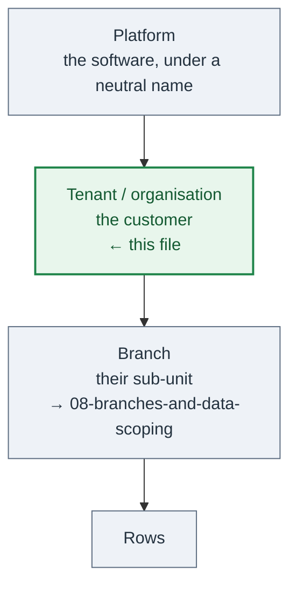
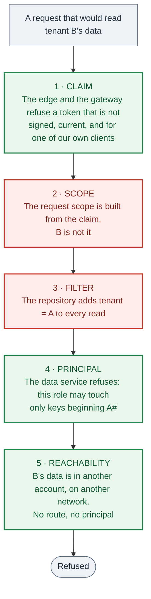
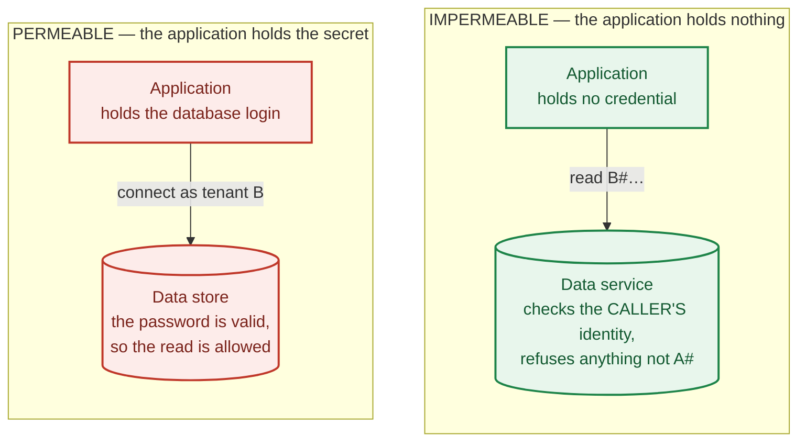
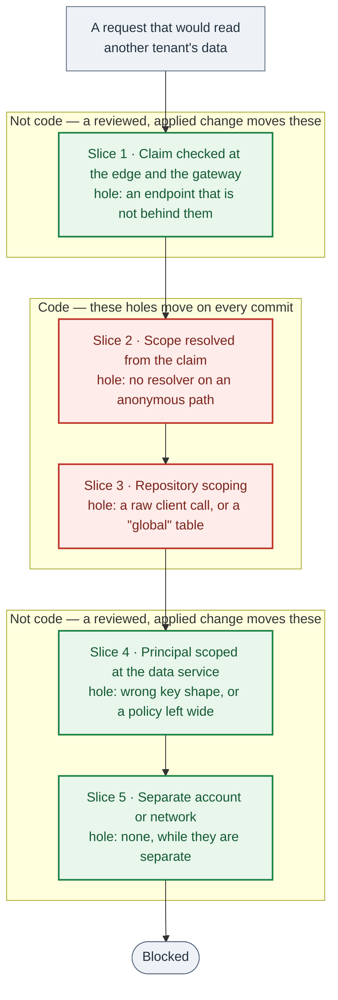

# 31 — Multi-tenancy: separate customers

A **tenant** is another **customer**. Another organisation, with its own contract, its own
brand, its own administrators, its own data controller, and its own right to take its data
and leave.

That is not the same thing as a sub-unit inside one customer — a region, a chapter, a depot,
a team. Those are **branches**, and they are
[08-branches-and-data-scoping](08-branches-and-data-scoping.md). The two get confused
constantly, and the confusion is expensive in one direction: a system built for branches and
then sold to a second customer has to answer questions it never asked.



The one-line test: **if the person at the top may legitimately see all of it, it is
branches. If they must not, it is tenants.**

Reference implementations. Reference B (C#, relational) has run **database-per-tenant** in
production for years, and most of the concrete mechanism below is its shape. Reference A
(TypeScript, key/value cloud store) has branches only, and a written plan for adding the
tenant level above them; its plan supplies the constraint analysis in § 3 and § 6.

---

## 1. Do these before the first customer

Almost nothing here is a refactor. The topology (§ 2) is one call, and the rest is
configuration that must exist before the first brand literal is typed (§ 8).

These are the one-way doors. Walk through one and the fix is a migration, not an edit:

| One-way door | What it costs later |
|---|---|
| A table or resource named after the first customer | Renaming a deployed table means migrating its data |
| A globally unique key that should have been tenant-scoped | Two customers want the same slug on the day you find out |
| Anything "shared" that is shared across customers | Each one is a cross-customer read, found one at a time |
| An all-powerful top-level role | Splitting it later means auditing every endpoint that trusts it |
| A mobile application identifier | Store identifiers cannot be changed after publication |

**Build for one customer, and walk through none of them.** § 11 is the list.

---

## 2. The topology: silo first, and pooled only with a barrier under it

Three shapes exist. The verdict is at § 2.4; read § 2.1 to § 2.3 first, because the
reasoning is what tells you when to leave the default.

| | **A. Silo** — one deployment per customer | **B. Pooled** — one deployment, a tenant column | **C. Store-per-tenant** — one deployment, one data store each |
|---|---|---|---|
| Isolation | Physical. Separate account or project | Logical. Every row carries `tenantId` | Physical at the data layer, shared compute |
| A missed filter | Cannot reach another customer | **Reads another customer** | Cannot reach another customer |
| Fixed cost | × number of customers | One | One, plus one store each |
| Cost of an idle customer | Full fixed cost | Almost nothing | The store's running cost |
| Provisioning | A deploy | A row | Create and migrate a store |
| Noisy neighbour | Impossible | Shared quotas (§ 6) | Shared compute only |
| Per-customer release | Possible, and becomes expected | No | No |
| Offboarding | Hand over an account | Export filtered rows | **Hand over a database** |
| Fits a key/value cloud store | Yes | Yes — the default there | Only with a store that has databases (§ 3) |
| Fits a relational store | Yes | Yes | Yes — the normal answer there |

### 2.1 Barriers: what actually stops a cross-tenant read

Every topology is a stack of barriers. They are not equal, and one question separates
them: **can the running application get past this barrier by changing its own code?**



Red is code the application can change. Green is enforced outside the application.

| Barrier | Enforced by | Defeated by | Survives a developer deliberately editing the application? |
|---|---|---|---|
| A tenant condition written into a query | That line of code | Deleting the line | **No** |
| A scoped repository base class | The base class and the type system | Calling the raw client instead | **No** |
| One database login that can reach every tenant | Nothing. The process holds it | Changing one string | **No** |
| A per-tenant database login the process can fetch for any tenant | The process asking for the right one | Asking for another tenant's | **No** |
| **The compute's own identity, scoped at the data service** — a condition on the leading key, a prefix-scoped storage policy, a role per tenant | The data service, against the caller's principal | Obtaining a different principal | **Yes** |
| **A separate account or network** | There is no route and no principal | An infrastructure change | **Yes** |

### 2.2 A secret the application holds is not a barrier against the application

**If the running code can obtain the credential, the credential does not stop the running
code.**



On the left, one edited line reaches tenant B. On the right, no edit does, because the
policy is not in the repository.

- **A database username and password in the configuration is reachable by every line of
  code in that process.** A developer who edits one line to point at another tenant's
  database succeeds, and nothing outside the process objects.
- **Fetching a per-tenant credential at request time is the same thing, one step removed.**
  If the process can ask the secret store for any tenant's credential, the barrier is again
  "the code asked for the right one".
- **Make the compute's own identity unable to name the other tenant's data.** Then the
  refusal comes from the data service rather than from your code, and the only way through
  is to obtain a different identity — an infrastructure change, reviewed, applied and
  logged, not an edit.

Use the cheapest of these that your key shape allows:

1. **Scope the compute's role by key prefix** — a condition on the leading key value, so the
   role may address only items whose key begins with the tenant. One policy. No new
   infrastructure. **This is the one to reach for first.**
2. **Scope object storage by prefix** in the same way, so files are separated by a policy and
   not only by a path ([08-branches-and-data-scoping](08-branches-and-data-scoping.md) § 6.2).
3. **Derive a scoped-down session from the caller's own verified token**, so the credentials
   that exist during that request cannot address another tenant at all.
4. **A role per tenant**, assumed from the verified claim. Take this when the data service
   has no key-prefix condition.
5. **A separate account per tenant** (silo), where there is nothing to scope because there is
   nothing shared.

**The caveat that decides whether you get any of this:** a leading-key condition works only
when the tenant is the leading part of the key — which is exactly what
[08-branches-and-data-scoping](08-branches-and-data-scoping.md) § 7 already requires. Get the
key shape wrong and this barrier is not available at all. That is why the key shape is fixed
on day one and not revisited.

### 2.3 The swiss cheese model: never ship a stack that is all code

Each barrier is a slice with a known hole. A breach needs the holes to line up. What
matters is which slices are code, because code holes move on every commit.



- **Slices 2 and 3 are code.** One merged pull request can open a hole in either, and the
  guard tests of § 12 are the only thing watching.
- **Slices 1, 4 and 5 are not code.** Their holes move only when the infrastructure changes
  — a separate file, a separate review, a separate approval, an applied plan and an audit
  record ([15-infrastructure-and-environments](15-infrastructure-and-environments.md)).
- **A stack that is all code is one merged pull request from a breach. Do not ship one.**
  Slice 1 is free and you should already have it
  ([18-security-and-privacy](18-security-and-privacy.md) § 1). Slice 4 is one policy.

> **With slice 4 or slice 5 in place, a developer who deliberately edits the application to
> read another tenant's data does not succeed by editing the application.** The data service
> refuses the principal. To succeed they must change the infrastructure — a reviewed, applied
> and audited change — or obtain a different identity. That is the difference between "we
> trust the code" and "the code is not trusted."

The limit of that claim, stated so the claim stays worth making: **someone who can change
the infrastructure and get it applied can still do it.** Keep that change visible, reviewed
and recorded, and keep the deploy role that can make it separate from the role the
application runs as
([28-supply-chain-and-build-inputs](28-supply-chain-and-build-inputs.md) § 7).

### 2.4 The verdict

- **Start with silo.** Nothing new can leak, because there is nothing shared to leak
  through. Its costs — money and release effort — are visible, and neither of them is a
  breach. Stay there until the per-customer fixed cost, or the per-customer release
  expectation, actually hurts.
- **Move to pooled when idle customers get expensive, and only with slice 4 underneath it.**
  Pooled with code-only barriers is the one combination to refuse: every endpoint, every
  query and every "global" call becomes load-bearing for isolation, and all of them are
  code. Pooled with the compute's identity scoped by key prefix (§ 2.2), the guard tests of
  § 12, and § 5.1 worked through item by item is sound.
- **On a relational store, prefer store-per-tenant over pooled.** It is the normal answer
  there, it makes offboarding a database hand-over, and Reference B has run it in production
  for years (§ 4).
- **Do not put a protocol-adapter store-per-tenant in production yet** (§ 3.1). Run it as
  the local and test store, where a gap costs nothing.

---

## 3. What the cloud store does to the choice

This set assumes a managed cloud key/value store — Reference A uses DynamoDB. Three of its
properties decide which topologies are even available:

- **Table names live in one flat namespace per account and region.** There are no databases
  or schemas to nest them in, so "the same table name for each customer" is not expressible.
  Separating by name means `acme-orders`, `globex-orders`, … for **every** table.
- **The account has a quota on tables.** The default is in the low thousands and can be
  raised on request. Check the current number; do not design against a remembered one.
- **A table is a deployed resource** with its own indexes, protection settings, backups,
  alarms and entry in the infrastructure state.

Reference A's one deployment has **137 tables**. So:

| Idea | What actually happens |
|---|---|
| A table set per customer | 137 × customers. The account table quota stops the product in the low tens of customers, and every infrastructure apply grows with it |
| A tenant prefix on every table name | A rename of all 137 tables, and the quota problem is unchanged |
| **A tenant attribute in the key** | No new tables, ever. This is why pooled is the default in a key/value store |
| A separate account per customer | Silo. Works, and the fixed cost repeats per customer |

Two further things bite before the quota does: an infrastructure plan over thousands of
tables is slow enough to change how the team works, and a permission document that lists
tables by name stops fitting in the size limit. One that names a **prefix** does not.

### 3.1 Store-per-tenant on a key/value store

Option C needs a store that **has** databases. A wire-compatible adapter — a server that
speaks the same protocol and stores the data in a relational database — gives you that
without changing a line of repository code: only the endpoint and the credentials differ per
customer, and the table names stay as they are.

**Do not put this in production yet. Run it as the local and test store.** The trade, in
full, because it moves the whole operational model:

- **Gained:** physical per-customer isolation with no table rename; a customer can hold
  their own database, even on their own infrastructure; offboarding is a database hand-over;
  a missing tenant filter cannot read another customer, because the rows are elsewhere.
- **Paid:** servers and a database to run, patch, back up and monitor, where there were
  none; compute inside a private network, which puts every other outbound call behind a
  gateway; static credentials in a secret store instead of a role; per-customer fixed cost
  even while idle; the managed store's own recovery and export features replaced by the
  database's.
- **Where it earns its place today:** as the local and test store, in place of the usual
  lightweight emulator, where it runs the same code path as production and a gap costs
  nothing ([14-local-dev-and-simulators](14-local-dev-and-simulators.md)). Before anything
  else depends on it, confirm that one such server gives each account its own table
  namespace, and how far its feature coverage really goes.

---

## 4. Store-per-tenant, in full

This is Reference B, in production. It is the clearest of the three, and even a pooled
design should read it, because § 4.5 and § 4.6 are needed either way.

### 4.1 Two kinds of database

| Central (one) | Per customer (one each) |
|---|---|
| The tenant registry: each customer, and **the name of their database** | Every domain table |
| Users, and which customer they belong to | The customer's own data, and nothing else |
| Platform administrators, and the platform audit log | |
| Billing: payments, subscriptions, payment-provider events | |
| Quotas and allowances: storage, usage units, limits | |
| Sign-in artifacts that must work before a customer is known: temporary tokens, OAuth records | |

The rule that keeps it clean: **the central database holds what the platform owns, and what
must be readable before the customer is known. Everything the customer owns is in their
database.**

### 4.2 Routing, per request

```
token → the customer on it → their database name → request-scoped state
                                                      ↓
                              connection provider reads that state
                                                      ↓
                              every repository on this request
```

Rules:

- **The database name is resolved server-side from the authenticated token**, through the
  tenant registry. It is never a request parameter. A client that can name its database is a
  client that can name someone else's.
- **It is set once, at the start of the request, and is immutable for that request.**
- **It lives in one request-scoped state object** that the connection provider reads. No
  repository takes a connection string, and no repository knows which customer it is serving
  ([03-backend-domain-and-ports](03-backend-domain-and-ports.md)).
- A request that resolved no customer gets no customer database. It is not defaulted.

### 4.3 The cross-tenant override is one named thing, and a test forbids its spread

Background work, scheduled jobs and the operator console legitimately need to point a
request at another customer's database. Reference B has exactly one type that can do it.

**A guard test asserts that no use case takes that type as a constructor dependency.** It
reflects over every operation class and fails on any that does. That is the whole control,
and it is worth copying verbatim:

- A request-driven path that can choose its customer is the breach, not the mechanism.
- If a use case ever genuinely needs it, the test fails first and the decision gets made
  deliberately, instead of arriving unnoticed in a parameter list
  ([12-testing-integration-and-guards](12-testing-integration-and-guards.md)).

### 4.4 Provisioning from a pool

Creating and migrating a database takes long enough to be visible during sign-up. So the
platform keeps **pre-created, already-migrated, unattached databases**, and sign-up
*attaches* one:

- Take an unattached database; if there is none, create one now.
- Attach it to the new customer in the registry.
- An operator action tops the pool back up, and the count of unattached databases is a
  monitored number.
- The database name is **random**, not derived from the customer's name — checked for
  collision before use. A derived name leaks the customer list to anyone who can see a
  database name, and it strands you when a customer is renamed.

### 4.5 Migrations run per customer, and that is a release-shaped problem

There are **two** migration sets: central, and per-customer. The per-customer set runs once
for every customer database, including the unattached ones in the pool.

This is the part that gets underestimated:

- A deploy is not finished when the code is out. It is finished when every customer database
  is migrated.
- A migration that fails on customer 400 of 500 leaves the estate on two schemas. The
  migration runner must be re-runnable, must report per customer, and must not stop the
  others.
- Code must tolerate both schemas for the length of that window, exactly as in a rolling
  deploy ([16-ci-cd](16-ci-cd.md)).
- Migration time grows with the customer count. It is the first thing that makes a release
  slow.

### 4.6 Everything else that must iterate customers

Scheduled jobs, backups and batch work have no request and therefore no customer. Each one
takes an explicit **tenant enumeration** from the same registry the migrations use, and
loops, setting the override per customer.

- **Never a default.** A job that silently runs against one customer is a job that silently
  does not run for the others.
- **One customer's failure must not stop the rest.** Report per customer and continue.
- **Backups are per customer**, named per customer, and restorable for one customer without
  touching another. That is most of why this topology is bought.

---

## 5. Pooled mode: what it actually takes

Pooled is a tenant attribute on every row — the same mechanism as
[08-branches-and-data-scoping](08-branches-and-data-scoping.md), one level up, with the same
explicit-not-ambient rule, the same base class, the same guard. What follows is everything
that mechanism does **not** cover.

**Before any of it: give pooled mode a barrier that is not code** (§ 2.2). Scope the
compute's own identity by the leading key value, so the data service refuses a read of
another tenant's items whatever the application asks for. Everything in § 5 is a slice with
a hole in it; that one is not, and it is a policy rather than a project.

### 5.1 Every "global" table is now a cross-customer leak

This is the single largest defect class, and every item is found separately, by hand.

**Scope every one of them to the tenant.** Keep a global one only where the data is the
platform's own and no customer can write it — a country list, a unit table, a public
reference set — and write that reason beside it.

These are the shapes that were right across one customer's branches and are wrong across
customers ([08-branches-and-data-scoping](08-branches-and-data-scoping.md) § 3):

| Shape | What it becomes |
|---|---|
| A singleton settings or prompt-override row | One customer's configuration applied to every customer |
| A shared opt-out or suppression list | One customer's unsubscribes silencing another's |
| Content marked "shared globally" | One customer's material in another's library |
| A shared template or course catalogue | The same, plus an editing right across customers |
| A global tag or category namespace | A collision, and a list of another customer's terms |
| A shared reference data set | Usually still correct — write down why |

If you cannot write the reason in one sentence, it is not global. Scope it.

### 5.2 Keys that were globally unique stop being so

A branch slug that is the primary key is unique across the whole system. Two customers both
want `north`, `canterbury`, `main`. The key becomes `tenantId#slug`, by the rule in
[08-branches-and-data-scoping](08-branches-and-data-scoping.md) § 7, and the collision gets
its own declared error value.

### 5.3 The top-level role has to split in two

A single all-powerful role that bypasses every check and can switch into any branch becomes,
in pooled mode, a role that can read every customer. It splits:

- **Platform operator** — the vendor's own staff. Can cross customers. Few, audited, and
  every cross-customer action is recorded.
- **Tenant administrator** — the customer's own top role. Can cross their own **branches**,
  and nothing else.

Every endpoint that trusts the old role has to be re-read. That is why it is on the one-way
door list in § 1.

### 5.4 Resolving the tenant

**The verified claim on the token decides. Nothing else does.**

The host the request arrived on (`<branch>.<customer domain>` or
`<customer>.<platform domain>`) may choose which sign-in page to show and which identity
client to use. It does not grant anything. A tenant taken from a host, a header or a body
field is a tenant the caller chose, and treating it as authoritative is the breach.

Enforce the claim at the edge as well as in the application
([18-security-and-privacy](18-security-and-privacy.md) § 1): the gateway refuses a token
whose audience is not one of the platform's own clients before a handler exists.

---

## 6. The per-account limits that bite pooled mode

A pooled deployment shares one cloud account between all customers, and several platform
services are **one per account** or **one per region**. Each of these has stopped a pooled
design somewhere:

| Limit | Consequence |
|---|---|
| One **active** inbound-mail receipt rule set per account and region | Inbound mail for every customer goes through one rule set |
| One custom domain per identity pool | Each customer on their own sign-in host needs its own pool, or everyone shares one neutral host |
| Messaging sender identifiers registered per account | One sender name for every customer, unless each registers their own |
| Resource name-length budgets | A per-customer prefix on an already-long name does not fit |
| Certificate, domain and distribution counts per account | A ceiling on customers, separate from the data |
| Shared request, concurrency and throughput quotas | One busy customer degrades the others |
| A shared table quota (§ 3) | Any per-customer table is multiplied |

**Count these before you commit to pooled, and put the numbers in the decision record.**
They are the limits that do not show up in a prototype with two customers, and each one is
a ceiling on how many customers the deployment can hold — a different ceiling from the
data.

---

## 7. What is per-tenant and is not a row

Isolating the data is the part everyone plans. This table is the part that gets found later:

**Authentication stays managed, and stays enforced at the edge, in every topology.** One
managed identity service, its hosted sign-in page, and the token checked at the content
delivery network or load balancer and at the API gateway before any handler runs
([18-security-and-privacy](18-security-and-privacy.md) § 1). Multi-tenancy is not a reason
to write a sign-in form, a session store or a token issuer: a per-tenant sign-in page is a
**branding** problem ([30-sign-in-branding-and-email](30-sign-in-branding-and-email.md)),
and a per-tenant boundary is a pool, a client or a claim — never your own code on the
authentication path.

| Per tenant | Notes |
|---|---|
| Identity pool, sign-in host, token audience | § 6 — usually the first hard limit. One pool with a tenant claim is the low-risk default; a pool per tenant only when a customer must own its own sign-in host |
| Mail sending identity, with its own SPF, DKIM and DMARC records | A customer sends as themselves, or not at all ([30-sign-in-branding-and-email](30-sign-in-branding-and-email.md)) |
| Inbound mail address or domain | § 6 |
| Messaging sender identifier | § 6 |
| Custom domains and their certificates | Including the sign-in host |
| Brand: names, logo, colours, fonts, imprint, legal text | § 8 |
| File storage prefix, and the signed-link policy over it | A prefix per customer, never a shared directory |
| Billing, subscription, payment-provider customer | Central, in every topology |
| Quotas and allowances, and what happens at the limit | Central |
| Any generative-AI context describing the organisation | Prompts carry the brand too |
| Mobile application identity | One neutral application that picks a customer, or one per customer (§ 9) |
| Data controller, privacy notice, retention policy | Legal, per customer, and it drives deletion |

---

## 8. Brand configuration is one object, and no literal escapes it

White-labelling fails in one specific way: the brand is not in one place, so "change the
name" is a search across the repository, and the search is never complete. Reference A
measured its own: **1,710 matching lines in 594 files** for one brand word, mixed in with
unrelated uses of the same word.

The rule: **every brand value comes from one configuration object, and no brand literal
exists in source outside that object's files.**

- **A schema-validated file per customer, in version control**, reviewed like code. Start
  with exactly one, holding today's values, so the first change alters no output at all.
- **A byte-identical test for that first change.** Every email, every public page, rendered
  before and after, identical. That is what makes a 594-file change safe.
- **A guard test for the rule itself:** no brand word, domain or sender name as a literal
  anywhere outside the configuration files, tests and fixtures. Put it in the gate. It is
  the "did we get all of them" check, and it is also what stops the next one appearing
  ([12-testing-integration-and-guards](12-testing-integration-and-guards.md)).
- **A branch may override a small, listed set** of those values — a join link, an imprint, a
  hero image, a sender name. Everything else inherits. Keep that list short and explicit.

### 8.1 Delivery: one mechanism per consumer

| Consumer | How it gets the configuration |
|---|---|
| Infrastructure | Generated variables per customer and environment, written by a script, never committed ([06-api-contract-and-codegen](06-api-contract-and-codegen.md)) |
| Server, run time | A configuration port, read at start from the environment. **Missing value is a start failure, never a fallback** ([07-composition-and-entrypoints](07-composition-and-entrypoints.md)) |
| Web client, run time | One anonymous endpoint returning the brand for the current host, cached for first paint |
| Web client, build time | Page title, icons, and any pre-rendered share pages, generated before the bundle |
| Mobile, build time | Application name, identifier, icons, splash, permission strings |
| Mobile, run time | Display name, theme, logo, categories — cached with the offline store ([10-mobile](10-mobile.md)) |

**A fallback brand value is a defect.** It means a misconfigured deployment starts and
serves the wrong customer's name instead of refusing to start.

---

## 9. The mobile application

**Build one neutral application that picks the customer.** Treat a per-customer listing as
a paid option, taken only when a customer requires its own.

- **One neutral application that picks the customer** — the default. Discovery before sign-in — a code, or
  the email domain, resolved to that customer's API host and identity client. The customer
  becomes part of the local storage namespace. One listing, one review, one set of signing
  keys. A neutral listing also avoids a store rejecting an application that looks like it
  impersonates an organisation.
- **One application per customer** — only when a customer requires their own listing. Each
  one costs a store review, its own signing keys, its own metadata, and its own release
  process, on every release, forever.

---

## 10. The lifecycle nobody designs until it happens

**Provision:** create the data store or the rows, run the migrations, attach the domains and
the identity, verify the mail identity, seed the defaults, record the customer in the
registry. From a pool where that takes too long to do during sign-up (§ 4.4).

**Suspend:** non-payment, or a customer request. **Suspended means read-only, on one flag,
with the data untouched.** Sign-in still works, so the customer can see their data, pay, and
export. Hiding the data or refusing sign-in turns a billing problem into a support incident
and an accusation of holding data hostage.

**Export:** the customer is entitled to their data. In store-per-tenant this is a database
hand-over. In pooled it is a filtered export, and **the filter is the same code path that
the isolation tests cover**, or it will miss a table.

**Delete:** on request, and on the retention policy. Every store, every file prefix, every
backup, every search index, and the registry row. Write the list down when the feature is
built, not when the request arrives, and test it.

---

## 11. The cheap path to being ready

You do not need the topology before the first customer. You do need to avoid the one-way
doors in § 1. Do these, in order, while there is still only one customer:

1. **Build the brand configuration object now** (§ 8), with one customer in it and a
   byte-identical test. It is topology-independent and it is the expensive part to retrofit.
2. **Add the neutral-strings guard to the gate** (§ 8) on the same day.
3. **Give the platform a neutral name and a neutral domain**, separate from the first
   customer's brand.
4. **Name no table, bucket, queue or role after the first customer.**
5. **Scope the keys as if there were a tenant above the branch** — write in each decision
   record which rule the key follows ([08-branches-and-data-scoping](08-branches-and-data-scoping.md) § 7).
6. **Keep the list of deliberately global data** (§ 5.1) as a list, in one place, so the
   migration is a review rather than an archaeology exercise.
7. **Split the top-level role** before anything else trusts it (§ 5.3).
8. **Put one barrier that is not code under the data access** (§ 2.2): scope the compute's
   role by the leading key value. It costs one policy, it works with one customer, and it is
   the slice that still holds when a code barrier is removed.
9. **Then choose:** silo for the first few customers, because it adds no new leak class and
   needs no data-model change. Re-decide at the point where the per-customer fixed cost, or
   the per-customer release expectation, starts to hurt.

---

## 12. Tests

- **Cross-tenant isolation**, modelled on the cross-branch suite
  ([08-branches-and-data-scoping](08-branches-and-data-scoping.md) § 8), over every table
  that stopped being global.
- **The cross-tenant override reachability test** (§ 4.3): no use case depends on the type
  that can switch customers.
- **The neutral-strings guard** (§ 8), in the gate.
- **A barrier test for the non-code slice** (§ 2.2), and it is the one test here that must
  run against the real data service rather than a fake: with the application's own role,
  read an item belonging to another tenant and assert the **data service** refuses it. A
  fake repository cannot fail this test, which is why it belongs with the integration tests
  ([12-testing-integration-and-guards](12-testing-integration-and-guards.md)).
- **An infrastructure guard** that the role policy still carries the key-prefix condition,
  so widening it is a failing test rather than a quiet commit.
- **Configuration schema tests:** a missing key, an over-long sender identifier, an invalid
  colour — each one a start failure with a message naming the key.
- **Byte-identical rendering** of every email and public page across the configuration
  change (§ 8).
- **A second configuration in the test suite** — a fictional customer — and a test that its
  rendered output contains no trace of the first customer's brand.
- **End to end:** a branch override shows on that branch and not on another; a customer's
  administrator cannot reach another customer's data through any list, search, export or
  client sync payload.
- **Migration estate test** (store-per-tenant): the runner migrates every store including
  the unattached pool, is re-runnable, and reports per customer.
