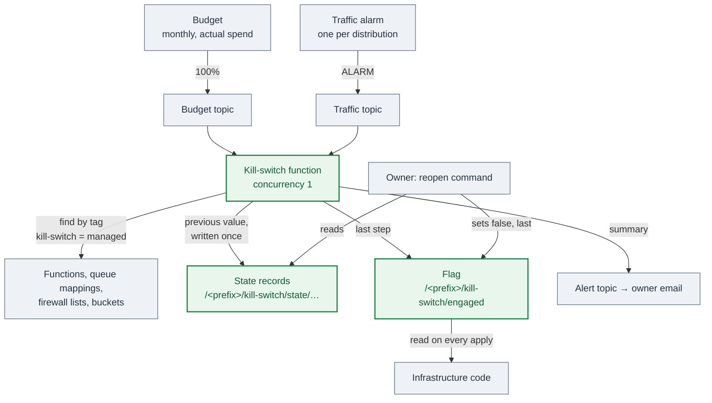

# 34 — Cost kill switch (optional)

**This feature is optional.** Adopt it when a runaway bill would hurt more than an outage:
a small project, a fixed budget, a sponsor who has set a hard ceiling, or a public surface
that bills per request and per byte. Skip it when every surface that bills by volume sits
on a flat-rate plan with no overage charge
([29-hardening-that-costs-nothing](29-hardening-that-costs-nothing.md) § 1.1), or when an
outage costs more than any likely bill.

A cloud account has **no hard spend cap**. Budgets and alerts send email; they do not stop
anything. A traffic flood on a distribution, a function that calls itself in a loop, or a
scraper on a public bucket keeps billing while the email waits to be read. The kill switch
is the part of the application that stops itself.

The service names are the ones Reference A uses (AWS). The swap point is the provider; the
shape — trigger, targets by tag, a record before every change, a flag the infrastructure
reads back, an owner-only reopen — is the same everywhere.

---

## 1. The rules

1. **The trip runs unattended.** Nobody commits, approves or applies before the app stops.
2. **An infrastructure apply while the switch is engaged does not reopen the app.**
3. **Every change is recorded before it is made, and the record is never overwritten.**
4. **The switch never deletes data or a resource.** Its role has no delete permission, and
   a guard test fails when one is added.
5. **Only the owner reopens**, with one command that reads the records back.
6. **The switch never switches itself off**, nor the alert function that tells the owner.
7. **A new resource joins by carrying a tag**, and a guard test fails when a resource that
   bills by volume has no tag.

---

## 2. Options that do not work

| Option | Why it fails |
|---|---|
| Budget actions that attach a deny policy | A deny on principals does not stop traffic. The distribution, a public bucket read and a presigned URL keep serving and keep billing. An organisation-wide policy needs an organisation, which a small account does not have. |
| An infrastructure variable `kill_switch_engaged = true` | It needs a human commit and apply before anything stops, so it is not a kill switch. Any apply between a manual stop and that commit reopens the app. |
| `ignore_changes` on every guarded attribute | It hides every later drift, and it also ignores the reopen. |

**The chosen shape:** a function changes the resources, and a flag in the parameter store
tells the infrastructure what the function did. Its one cost is two descriptions of each
shut-down value — the function code and the infrastructure code. A guard test pins them
together (§ 9).

---

## 3. The shape



Two modes share one function:

- **Account mode.** The kill-switch budget reaches 100% of actual spend. The switch shuts
  down every tagged resource in the account.
- **Distribution mode.** The hourly traffic alarm of one distribution fires. The switch
  closes that distribution's firewall list only, and changes nothing else.

---

## 4. Account mode

### 4.1 The trigger

- A **second** budget, separate from the early-warning budget. The early warning sends email
  and stops nothing; this one stops. Keep both.
- Email at 50%, 75% and 90% of actual spend. At 100%, email **and** publish to a topic.
  Reference A's provider publishes budget notifications to one region only, so the topic is
  in that region and the function subscribes across regions.
- The topic policy lets only the budget service publish, scoped to the account. On the test
  environment only, a second statement lets the account's own principals publish a manual
  message, `{"action":"engage","source":"manual"}`, for the drill (§ 10). The function
  ignores that message on production even if it arrives.
- The function accepts a budget message only when it **names the budget as a whole word**,
  so a budget called `x-kill-switch-2` does not trip `x-kill-switch`. Any other message is
  logged and changes nothing.
- Pin the budget's start period in code. A computed start date recreates the budget on a
  later apply.

### 4.2 Targets by tag

The switch finds its targets through the tagging API: every resource with the tag
`kill-switch = managed`. It never holds a list of names. A new function, bucket or firewall
list joins by carrying the tag and reading the flag (§ 6).

| Target | Shut-down value | Effect |
|---|---|---|
| Functions | reserved concurrency 0 | The API, the workers and the socket handlers do not run. |
| Queue event source mappings of those functions | `Enabled = false` | Messages wait in their queue. Their receive count does not rise toward the dead-letter queue. |
| Edge firewall lists (pay-as-you-go only) | default action Block, HTTP 503, body key `service-paused` | Visitors see the paused page. An API host answers the same sentence as JSON. |
| Buckets read through presigned URLs | bucket policy statement `KillSwitchDenyNonOwner` | Presigned URLs answer 403 from every address outside `owner_ip_cidrs`. |

**Excluded by name, even with the tag:** the kill-switch function and the cost-alert
function. Do not tag them either; a guard test fails when one carries the tag.

**Disable the queue mappings, do not only throttle the function.** A mapping that keeps
polling a function at concurrency 0 is throttled, and every throttle raises the receive
count of the message until it lands in the dead-letter queue. A disabled mapping leaves the
message where it is.

**Presigned URLs need the bucket statement.** No edge firewall covers a presigned URL, so
the bucket policy is the only place to stop it:

```json
{
  "Sid": "KillSwitchDenyNonOwner",
  "Effect": "Deny",
  "Principal": "*",
  "Action": ["s3:GetObject", "s3:PutObject"],
  "Resource": "arn:aws:s3:::<bucket>/*",
  "Condition": {
    "NotIpAddress": { "aws:SourceIp": ["<owner cidrs>"] },
    "BoolIfExists": { "aws:ViaAWSService": "false" }
  }
}
```

The switch keeps every other statement in the policy when it adds this one, and again when
it takes it out. A read grant for the distribution's origin access survives a trip and a
reopen.

**WARNING:** the statement also refuses the distribution's own origin fetch, because that
fetch does not come from an owner address. Files served through the distribution from a
denied bucket stop for everyone, the owner included. Write that in the decision record.

**WARNING:** the deny matches the source address. An owner who reaches the provider over
IPv6 with an IPv4-only `owner_ip_cidrs` is denied too. Put both prefixes in the list.

### 4.3 The order of one run

1. Find the tagged resources.
2. For each function: write the record, set concurrency 0, then disable its queue mappings.
3. For each firewall list: write the record, set the paused default action.
4. For each bucket: write the record, add the deny statement.
5. **Last:** set the flag `engaged = true`.
6. Publish a summary to the alert topic: the trip time, the counts per kind (changed now /
   already shut), the excluded functions, the missing targets and the failures. Send each
   failure to error tracking as well.

A target that does not exist is reported as **missing**, and the run continues. A target
that fails is reported as a **failure**, and the run continues. One bad target never stops
the others from shutting down.

The flag is set last so that a run that stops part way does not tell the infrastructure
the account is shut. A run **with** failures still sets the flag: the targets that did shut
down must stay shut on the next apply.

### 4.4 Records

Before each change, the previous value goes to one parameter:
`/<prefix>/kill-switch/state/<kind>/<id>`.

- **A record that exists is never written again.** A second run therefore never records the
  shut-down value as the previous value. Write with "do not overwrite", and read first.
- A function with no reserved concurrency records `unset`, not a number. The reopen removes
  the setting; it does not set a number the function never had.
- A bucket records `existed` or `none`, so the reopen knows whether to delete the whole
  policy once the deny is gone.
- A firewall list records `{ arn, defaultAction }` as JSON. A paused action is never
  recorded as the previous value: when the current action is already paused, the record
  takes the other mode's record, or the open action.

### 4.5 One run at a time

Give the kill-switch function **reserved concurrency 1**. A budget trip and a traffic alarm
that arrive together must not both read "no record" and then both write one. The topic
retries a throttled asynchronous invocation.

---

## 5. Distribution mode

Each distribution that bills by volume gets two alarms, each a sum over one hour, with one
evaluation period:

- **Requests.** With a managed firewall list, read the list's **allowed** requests
  (`AllowedRequests`, `Rule = ALL`), not the distribution's total. A blocked request costs
  almost nothing and must not close the site. Reference A learned this when one scanner sent
  3,816 requests for secret-file paths to the test API edge; every request got a 404 or a
  301, the total-requests alarm passed its threshold, and the switch closed the API.
- **Bytes downloaded.** Always the distribution metric. A blocked response is small.

The alarms publish to a second topic. The function then:

1. Finds the distribution. A requests alarm on the firewall metric names the **list**, not
   the distribution, so the function looks up the distributions that use that list. Exactly
   one closes; none or more than one is reported as missing and changes nothing.
2. Checks the list carries the tag. An untagged list is reported as missing.
3. Writes the record `/<prefix>/kill-switch/state/distribution/<list name>`, sets the
   paused default action, and sets `/<prefix>/kill-switch/distribution/<list name>` to
   `true`.

**Each mode keeps its own record.** An account reopen never reopens a distribution its own
alarm closed, and a distribution reopen leaves a list paused while account mode still holds
it. The infrastructure renders a list paused when either flag is true.

A distribution with no firewall list cannot be closed. Its alarms still fire, and the
summary email says the switch closed nothing.

### 5.1 Distributions on a flat-rate plan are not targets

A flat-rate plan has no overage, so there is nothing to stop. The provider also **refuses**
the features the switch needs on a plan firewall list — a custom response, a Block default
with a custom body — at apply time and at run time. Reference A's first production apply of
this feature failed on exactly that.

On a plan distribution:

- no `kill-switch = managed` tag on the firewall list,
- no paused default action and no custom response body,
- no traffic alarm and no distribution flag.

The module that adds the alarms takes an `on_pricing_plan` input that creates none of them.
Under account mode, a plan distribution keeps serving its static shell; the API behind it is
at concurrency 0, so the client shows the paused state (§ 7).

---

## 6. The flag the infrastructure reads back

The infrastructure owns the parameter. The switch and the reopen command own its value:

```hcl
resource "aws_ssm_parameter" "engaged" {
  name           = "/${var.prefix}/kill-switch/engaged"
  type           = "String"
  insecure_value = "false"

  lifecycle {
    ignore_changes = [insecure_value]
  }
}

output "engaged" {
  value = aws_ssm_parameter.engaged.insecure_value == "true"
}
```

The environment passes `module.cost_kill_switch.engaged` to every module as
`kill_switch_engaged`, and **every guarded attribute renders from it**:

```hcl
resource "aws_lambda_function" "worker" {
  # ...
  reserved_concurrent_executions = var.kill_switch_engaged ? 0 : var.worker_concurrency
  tags = { "kill-switch" = "managed" }
}

resource "aws_lambda_event_source_mapping" "worker" {
  # ...
  enabled = !var.kill_switch_engaged
}

resource "aws_wafv2_web_acl" "edge" {
  # ...
  default_action {
    dynamic "allow" {
      for_each = local.kill_switch_paused ? [] : [1]
      content {}
    }
    dynamic "block" {
      for_each = local.kill_switch_paused ? [1] : []
      content {
        custom_response {
          response_code            = 503
          custom_response_body_key = "service-paused"
        }
      }
    }
  }
}
```

`local.kill_switch_paused` is `var.kill_switch_engaged || <this distribution's flag>`.

The bucket statement comes from one small module with no resources: it takes the bucket ARN,
`owner_ip_cidrs` and the flag, and outputs zero or one statement. Each bucket module adds
that output to its own policy. The function writes the **same** statement, so an apply while
engaged plans no change.

**WARNING:** never apply with `-refresh=false` while the switch is engaged. The flag is read
from the refreshed state. A stale `false` reopens the app.

A bucket that has a policy only while engaged shows a `+ create` on the first plan after a
trip, with the same content the switch wrote. Applying it changes nothing in the provider.
Say so in the runbook, or the first person to see it will think the plan is wrong.

---

## 7. What the client shows

The client must tell "the service is paused" apart from "this request failed". Mark the
paused state from **one marker field**, never from free text:

```ts
export function isServicePausedResponse(status: number, payload: unknown): boolean {
  const body = payload !== null && typeof payload === 'object'
    ? (payload as { error?: unknown; message?: unknown })
    : {};
  if (body.error === 'service-paused') return true;               // the firewall body
  return status === 503 && body.message === 'Service Unavailable'; // the gateway with no function
}
```

- Only the `error` field counts. An error message can repeat a name a user typed, so a 409
  for a record called `service-paused` is not a paused service.
- Both answers count: the firewall's paused body (distribution mode, or a pay-as-you-go
  edge), and the gateway's own 503 when the function behind it is at concurrency 0 (account
  mode on a plan distribution).
- The API client sets a "paused" state on that answer, and **clears it on the next good
  answer**. A banner on every page reads the state. The mobile app shows the same state on
  its next sync, and keeps unsent changes on the device.
- The paused page is one static HTML file, under the firewall's custom body size limit
  (4 KB on Reference A's provider). The JSON body for an API host reads its sentence from
  that page, so a browser and an API client get the same text. A guard test checks both.
- The paused page says the site is busy and offers a retry. It names no budget and no cost.

---

## 8. Reopening

Only the owner reopens, with the owner's credentials. The kill-switch role cannot: it has
no delete permission, and reopening removes a concurrency setting, a bucket policy and the
records.

```bash
scripts/cost-kill-switch/reopen.sh --env <test|production> status
scripts/cost-kill-switch/reopen.sh --env <test|production> --dry-run
scripts/cost-kill-switch/reopen.sh --env <test|production>
scripts/cost-kill-switch/reopen.sh --env <test|production> --distribution <id> [--dry-run]
```

- The script checks the account identity first, and stops when the account does not match
  `--env`.
- `status` prints the flag and every record with its recorded and current value.
- `--dry-run` prints every change and makes none.

The order of an account reopen:

1. **Functions first.** A mapping that runs while its function is at concurrency 0 is
   throttled and raises the receive count of its messages.
2. Queue mappings.
3. Firewall lists. A list that distribution mode also holds stays paused.
4. Buckets: take out the deny statement, and delete the policy when no other statement
   remains.
5. Delete each record **after** its target is back.
6. Replay the held events (§ 8.1), only when nothing failed.
7. **Last:** set `engaged = false`, only when nothing failed.

A run with failures exits non-zero and keeps `engaged = true`. Fix the cause and run it
again; the second run continues from the records that remain.

A distribution reopen also sets each of that distribution's traffic alarms that is still in
ALARM back to OK. An alarm publishes only when its state **changes**, so an alarm left in
ALARM never closes the distribution again while the traffic stays high.

### 8.1 Held events

Some events arrive once and nobody can send them again: inbound email, delivery reports,
platform notifications. The provider keeps an asynchronous event for a limited time while
the function is at concurrency 0 (six hours on Reference A's provider), then drops it.

- Give each such function an **on-failure destination**: one held-events queue, kept for the
  maximum retention (14 days).
- The reopen replays each held event whose condition is "event age exceeded": the function
  never ran it.
- An event with any other condition ran and failed. A replay could write its data twice, so
  the reopen **keeps** it in the queue and prints `kept in the queue`. A person reads it
  first.
- A guard test fails when a function that an email or notification service invokes has no
  on-failure destination.

### 8.2 Work that waits, and for how long

The switch deletes nothing, but every queue has a retention limit. List each kind of work in
the runbook with where it waits and for how long:

| Work | Where it waits | After the reopen |
|---|---|---|
| Mobile changes | On the device | The app sends them again on the next sync. |
| Queue worker messages | Their queue, mapping disabled | The workers take them, if the queue still holds them. Raise retention to the maximum on queues that matter. |
| A message that holds short-lived data (cookies, a signed URL) | Its queue, with a short retention | Lost after its retention. The user starts it again. |
| One-delivery events | The held-events queue | Replayed (§ 8.1). |
| Live socket messages | Their dead-letter queue | Not replayed. A live message has no use later. |
| Scheduled jobs | Nothing: the schedule fires and is throttled | The next scheduled run does the work. |

---

## 9. Guard tests

The switch has two descriptions of each shut-down value. These tests read the infrastructure
code and the function code, and fail when they drift
([12-testing-integration-and-guards](12-testing-integration-and-guards.md)):

| Test | Fails when |
|---|---|
| Function wiring | A function carries no `kill-switch = managed` tag, or its reserved concurrency does not read `kill_switch_engaged ? 0 : …` |
| Excluded functions | The kill-switch function or the cost-alert function carries the tag |
| Queue mappings | A queue event source mapping does not set `enabled = !var.kill_switch_engaged` |
| Firewall lists | A pay-as-you-go list has no tag, no paused default action or no `service-paused` body; or a plan-capable list can render a feature its tier refuses |
| Distribution alarms | A distribution that bills by volume has no traffic alarms on the traffic topic; or the alarm module creates an alarm or a flag for a plan distribution |
| Bucket statement | A tagged bucket has no deny module; or the statement the infrastructure renders differs from the one the function writes |
| No delete | The kill-switch role grants an action that starts with `Delete`, or a wildcard action |
| Module inputs | A module call that declares `kill_switch_engaged` does not pass it |
| Held events | A function that an email or notification service invokes has no on-failure destination |
| Paused page | The page passes the custom body size limit, or the JSON message differs from the page sentence |
| Reopen script | A resource name the script uses differs from the name the infrastructure creates |
| Budget limits | An environment's limit differs from the value in the decision record, or an environment does not pass it |

The function itself follows the normal shape: one port for every provider call
([03-backend-domain-and-ports](03-backend-domain-and-ports.md)), an adapter that sends the
real calls, and an in-memory fake for the unit tests
([11-testing-unit](11-testing-unit.md)). Every decision — the record-once rule, the two-mode
records, the reopen order, missing versus failure, replay versus keep — lives in the core
and is unit-tested against the fake with full branch coverage.

```ts
export interface KillSwitchCloudPort {
  findManagedResources(): Promise<{ functionNames: string[]; bucketNames: string[]; firewallListArns: string[] }>;

  getReservedConcurrency(name: string): Promise<number | 'unset' | null>; // null: does not exist
  putReservedConcurrency(name: string, value: number): Promise<void>;
  deleteReservedConcurrency(name: string): Promise<void>;                 // reopen only

  listEventSourceMappings(name: string): Promise<{ uuid: string; enabled: boolean; queue: boolean }[] | null>;
  getEventSourceMappingEnabled(uuid: string): Promise<boolean | null>;
  setEventSourceMappingEnabled(uuid: string, enabled: boolean): Promise<void>;

  getFirewallList(arn: string): Promise<{ arn: string; name: string; defaultAction: unknown } | null>;
  setFirewallListDefaultAction(arn: string, defaultAction: unknown): Promise<void>; // sends the whole list back

  getBucketPolicy(name: string): Promise<{ policy: PolicyDocument | null } | null>;
  putBucketPolicy(name: string, policy: PolicyDocument): Promise<void>;
  deleteBucketPolicy(name: string): Promise<void>;                         // reopen only

  getDistributionFirewallList(distributionId: string): Promise<{ firewallListArn: string | null } | null>;
  listDistributionsByFirewallList(arn: string): Promise<string[]>;

  getParameter(name: string): Promise<string | null>;
  putParameter(name: string, value: string, overwrite: boolean): Promise<void>;
  deleteParameter(name: string): Promise<void>;                            // reopen only
  listParameters(path: string): Promise<{ name: string; value: string }[]>;
}
```

A read method returns `null` when the target does not exist. The core reports a `null` as a
missing target and moves to the next one.

**The local stack has a simulator.** A local route engages a paused answer — the gateway
503 or the firewall body — for every generated API route, and the local reset turns it off.
An end-to-end case then reads the paused banner from the real local API, not from a faked
response ([13-testing-e2e](13-testing-e2e.md), [14-local-dev-and-simulators](14-local-dev-and-simulators.md)).

---

## 10. The drill

Run it on the test environment, from a pipeline job with no credentials on a person's
machine:

1. Publish the manual message to the budget topic.
2. `status` shows `engaged = true` and every target recorded.
3. The web app shows the paused banner after its first API call. The API host answers 503
   with the `service-paused` body. The mobile app shows the paused state on its next sync.
4. A presigned URL from before the trip answers 403 from an address outside
   `owner_ip_cidrs`.
5. The plan of the next deploy shows **no change** to concurrency, mappings, firewall default
   actions or bucket policies, except the expected `+ create` of § 6.
6. `--dry-run` lists the changes and makes none.
7. Reopen. The app works. `status` shows `engaged = false` and no records.

Distribution mode: set one bytes alarm to ALARM by hand, check the one distribution answers
the paused page and the others still work, reopen it with `--distribution`, and set the
alarm back to OK.

Production does not accept the manual message. The topic policy has no statement for it, and
the function ignores it outside the test environment.

---

## 11. Choosing the numbers

- **Set the test environment's limit above its normal monthly spend.** A limit below the
  normal run rate shuts the environment down before the end of every month. Reference A's
  test environment tripped on day 23 of a month at a limit below its fixed charges, and the
  limit was raised to clear them.
- **Measure the fixed charges first.** Firewall lists and rules bill per month, not per
  request ([29-hardening-that-costs-nothing](29-hardening-that-costs-nothing.md) § 7). They
  count toward the budget even when there is no traffic.
- **Set traffic thresholds from data.** After the first production release, read 14 days
  of the hourly sums and record the highest hour beside each threshold in the runbook.
- **Keep a per-address rate rule below the alarm.** One address should hit the rate rule
  long before it can close a distribution for every user.
- Record each limit and each threshold in the decision record, and pin them with the
  budget-limit guard test.

---

## 12. What it does not do

- **The budget lags the bill by hours.** The provider reads billing data late, so spend
  can pass the limit well before the switch trips. The hourly traffic alarms cover the
  traffic part of that gap.
- **A budget notifies once per threshold per period.** After a reopen, the switch does not
  trip again in the same month, even if spend keeps rising. Watch the early-warning emails
  until the month ends.
- **The owner sees the paused app too.** The identity provider and the other managed
  services call the functions from provider addresses, so an owner-address exception on the
  firewall does not let the owner use a paused app. Only the bucket deny exempts the owner.
- **It does not stop the storage bill.** Stored data keeps billing. The switch stops the
  charges that grow with use.

---

## 13. Adopting it

1. Write the decision record ([20-decision-records](20-decision-records.md)): the limit per
   environment, the owner addresses, the targets, and what stays open.
2. Add the parameter-store flag and the `kill_switch_engaged` input to every module, and
   render each guarded attribute from it (§ 6). Add the guard tests of § 9 in the same
   change.
3. Add the function, its role with no delete action, its two topics and the second budget
   (§ 4).
4. Add the traffic alarms to each pay-as-you-go distribution (§ 5), and the held-events
   queue to each one-delivery function (§ 8.1).
5. Add the paused state to the web client and the mobile client, and the local simulator
   (§ 7, § 9).
6. Write the reopen script and the runbook, with the table of § 8.2.
7. Run the drill (§ 10) on the test environment before the first production release.
