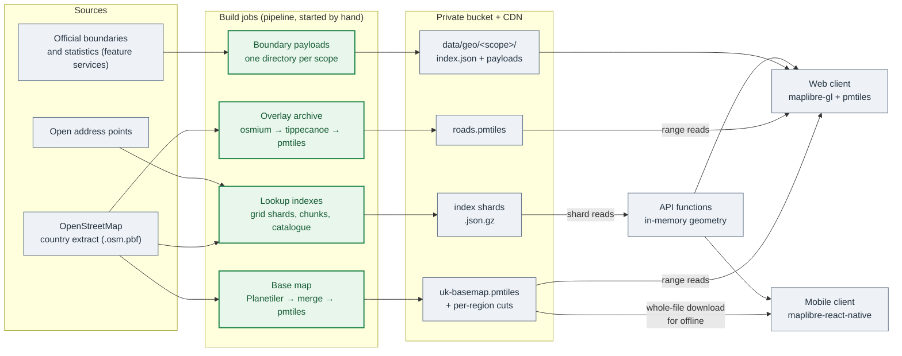

# 35 — Maps and geographic data

Adopt this file when the application draws a map, stores places, or matches records to
streets, boundaries or areas. Skip it when the only map is a static picture of an address.

The application serves its own maps. A build process turns open source data into a small
number of static files: a vector base map, overlay archives, lookup indexes and boundary
payloads. A content delivery network (CDN) serves those files from a private bucket. The
web client and the mobile client draw them with the same map library and the same style.
No map view sends a request to a third-party tile server.

The tool and service names are the ones Reference A uses (AWS, MapLibre, PMTiles,
OpenStreetMap). The swap points are the data source, the archive format and the map
library. The shape — build once from a pinned source, publish static files, read them by
range, key every record on the source's own feature id — is the same everywhere.

---

## 1. The rules

1. **No third-party tile server in the request path of a map view.** A public tile server
   can block the application at any time, its usage policy does not allow heavy use by an
   app, and each view sends the viewer's address to a third party.
2. **Map data is a build output, never hand-written.** Every archive, index and payload
   comes from a script that runs in the pipeline from a named, dated source.
3. **Local and test data come from the same build.** A fixture is a committed slice of
   real build output. A seed never invents an identifier, a geometry or a field that the
   build does not write ([21-agent-working-rules](21-agent-working-rules.md) § 1).
4. **Every stored record keys on the source's own feature id** (for OpenStreetMap, the way
   id). A record never keys on a name, a list position or an id that the application
   made.
5. **The server has no spatial database.** Spatial lookup is a fixed grid of static
   shards and an in-memory calculation inside the function (§ 6).
6. **Map files are static and immutable once published.** A new build writes a new
   generation. A small pointer file names the current generation.
7. **Every source has a recorded licence**, and the publish step fails closed when a
   restricted source is about to go public (§ 7.3).
8. **The serving cost has a fixed bound per client address.** Range-only reads, a maximum
   range size and a per-address rate rule (§ 8).
9. **The editing model is written in the project, not taken from a drawing library.**
   Shared corners, snapping and undo are domain rules with unit tests (§ 9.3).
10. **One coordinate system on the wire: WGS84 longitude and latitude.** Projection happens
    only inside a renderer.

---

## 2. Options that do not work

| Option | Why it fails |
|---|---|
| Raster tiles from the public OpenStreetMap tile server | The tile policy forbids heavy app use, the server can block the app, and every view leaks the viewer's address. |
| A paid tile provider | A key in the client bundle, a bill per view that a scraper can run up, and a third party in the request path. |
| A tile server that renders raster tiles | A server to run and patch, and a cache to size. A static archive does the same work with no process. |
| A spatial database for street and boundary lookup | A second store to run, back up and secure, for data that changes only when the build runs. A grid of static shards answers the same queries. |
| A drawing library for area editing | Its model is "a list of independent polygons". Areas that share corners, snap to roads and never overlap are domain rules; the library fights them. |
| One file per tenant scope that holds the whole country | The client downloads megabytes it never draws. Cut the data per scope (§ 7). |

---

## 3. The shape



Four kinds of output, each with its own build job:

| Output | What it holds | Read by |
|---|---|---|
| **Base map archive** | Every background feature: land, water, roads, buildings, labels, points of interest | Both clients, by range |
| **Overlay archive** | One feature class the application works on (roads), with the source feature id on each feature | Both clients, by range |
| **Lookup indexes** | Name-to-feature and place-to-feature indexes, cut into grid shards and per-region chunks | The API |
| **Boundary payloads** | Official boundaries and statistics, one directory per tenant scope, with a manifest | The web client |

---

## 4. The base map

### 4.1 Build

1. Download the country extract of OpenStreetMap (Reference A: the Geofabrik United
   Kingdom extract, ODbL).
2. Run **Planetiler** (a single Java jar, pinned by version and SHA-256) with the
   **OpenMapTiles** profile. It writes an MBTiles file in the OpenMapTiles schema.
3. When the schema lacks a feature the users need, run Planetiler a second time with a
   **custom YAML profile** that writes only the extra layers. Reference A adds social
   facility grounds, parking areas, the denomination of places of worship and the names of
   plain buildings.
4. Merge the two MBTiles files tile by tile into one. Reference A does this with a short
   script that uses only the standard library (SQLite, gzip, JSON).
5. Convert to one **PMTiles** archive with the `pmtiles` command-line tool
   (`pmtiles convert`), and write the source URL, the source data date and the tool
   versions into the archive metadata (`pmtiles edit`).
6. Check the archive (header, bounds, zoom range, a sample of tiles) before upload.

Rules:

- **Clip to the country box.** Outside the box the map is empty. This is the cost of a
  small archive, and the decision record says so.
- **Stop at zoom 15.** The map library overzooms vector tiles past the archive's maximum,
  so labels and lines stay sharp. Reference A: 3.1 GB and 2.1 million tiles for the UK.
- **No fallback to a public tile server.** When the archive header or the style fails to
  load, the client shows an error banner. One failed tile stays silent.
- **The base map does not update by itself.** A person starts the build job to take newer
  source data. The metadata records which data the archive holds.

### 4.2 Style

- Take a published style for the schema and **vendor it into the repository** as code,
  with the upstream commit recorded. Reference A uses the "OSM OpenMapTiles" style, the
  OpenMapTiles port of the OpenStreetMap Carto look, so the map looks like the map users
  already know.
- Keep the project's changes to the style in one module that both clients import. Name
  each change: "show these layers one zoom sooner", "repeat road names every 250 px",
  "draw the extra layers".
- **Serve the glyphs (fonts) and the sprite (icons) yourself.** The web client serves
  them from its own origin. The mobile client bundles them in the app and reads them with
  `asset://`. A style that points at a third-party glyph server breaks rule 1.

**Why the OpenMapTiles schema and not a lighter one.** A lighter schema (Reference A
tried Protomaps first) holds fewer street names, no parking and no shop icons. The owner
compared the two side by side with the raster map users knew, and asked for its features.
Pick the schema by the features the users need, not by the archive size.

### 4.3 Per-region cuts

Cut one archive per region for clients that work offline (§ 10.2): `pmtiles extract`
with the region's polygon grown by a margin (Reference A: one mile). Publish the cuts
under a generation directory with a `latest.json` pointer.

---

## 5. Overlay archives

An overlay archive holds the features the application works on, so the client can draw
them, filter them and select them by the source id. Reference A has one: roads.

1. Filter the extract with **osmium** (`osmium tags-filter`). Drop what nobody works on:
   footway crossings, sidewalks, unnamed driveways, parking aisles.
2. Export to GeoJSON with the source id on each feature (`osmium export --attributes=id`).
3. Tile with **tippecanoe**:

   ```
   tippecanoe --projection=EPSG:4326 -z15 -Z12 --simplification=2 \
     --no-feature-limit --no-tile-size-limit --detect-shared-borders \
     --use-attribute-for-id=@id --layer=roads
   ```

4. Convert to PMTiles (`pmtiles convert`).

Rules:

- **The feature id in the tile is the source feature id** (`--use-attribute-for-id`). The
  client filters with a `match` expression on the id, and every stored record names the
  same id.
- **Lossless from the minimum usable zoom.** No feature limit and no tile-size limit, so
  no feature disappears from a dense tile. The build script refuses a minimum zoom below
  the one the client needs (Reference A: 12), because below it the archive cannot hold
  every feature without dropping some.
- **A guard test reads the fixture archive header** and fails when the client's minimum
  zoom and the archive's minimum zoom disagree.

---

## 6. Lookup without a spatial database

The API answers "which features are near here", "which features have this name" and
"which features are inside this area" from static files.

### 6.1 Grid shards

- Cut the index into fixed grid cells (Reference A: 0.1° of longitude and latitude). A
  query reads the cell of the point and, at most, its eight neighbours.
- Name the cell in the key: `<prefix>/v2/<cell>.json.gz`.
- Store each shard gzipped in a **compact, lossless format**: coordinates as integer
  micro-degrees, a version number in the key, and one codec module that the build, the
  API and the tests all import.
- **Set a budget and test it.** Reference A caps a query at 64 cells and records the
  worst-case read (nine cells, 18.85 MB uncompressed) in the decision record.
- Put a hard limit on any fallback search radius (Reference A: 2,000 m). A search with no
  limit reads the country.

### 6.2 Per-region chunks

When a query belongs to one region, read one file. Write one chunk per region, cut to the
region's bounding box grown by a margin (Reference A: 1,000 m), so a feature on the edge
is in both chunks. A small generated file holds every region's box, and one function
chooses the chunk for a box.

### 6.3 Catalogues and content addressing

- **Immutable generations.** A catalogue build writes
  `<prefix>/v1/<generation>/<region>.json.gz` with a one-year cache, and a `latest.json`
  pointer with a five-minute cache. A client never reads a half-written generation.
- **Content-addressed results.** A derived result that many clients read (for example,
  which streets belong to which area for one layout version) is named by a SHA-256 of its
  bytes. The client caches it in IndexedDB by that name and never asks twice.

### 6.4 Geometry in the function

The function loads the shard or chunk, runs the geometry in memory and returns the
answer. Point-in-polygon over many points uses a coarse raster of the polygon (Reference
A: a 20 m grid) before the exact test. Distance to a segment uses a local
equirectangular projection, which is exact enough at street scale.

---

## 7. Boundary and statistics payloads

### 7.1 Source and shape

- Read official boundaries in **WGS84** from the publisher's feature service, paged. Ask
  the service for WGS84 (`outSR=4326`); do not reproject in the build.
- Take the publisher's **generalised, coastline-clipped** product (Reference A: the ONS
  "BGC" boundaries, generalised to 20 m), not the full-resolution one. It is about 20
  times smaller, and the build does no simplification of its own.
- Assign membership (which small area is in which region) from the codes the publisher
  puts on each record, not by clipping geometry.

### 7.2 One directory per scope

- Write one directory per tenant scope: `data/geo/<scope>/`. The scope is in the path, so
  one scope never downloads another scope's data
  ([08-branches-and-data-scoping](08-branches-and-data-scoping.md)).
- Write `index.json` **last**. It holds the bounding box, the centre and the file list. A
  reader that finds the manifest finds every file it names.
- Every payload carries `meta`: the scope, the licence and the source URL.
- A scope that covers several regions reads each region's manifest and merges them in the
  client. Write **one merge rule per file kind**. A file with no rule throws; it is never
  silently skipped or concatenated.
- One generated registry lists every region and its scope slug. The build loops over it,
  and a test checks every slug is legal and unique.

### 7.3 Licences and the publish check

- Keep one table of sources, publishers and licences in shared code. The client reads it
  to show attributions. When the mobile client keeps its own copy, a test fails when the
  two differ.
- A guard test fails when a map layer file has no row in the licence table.
- **The publish step fails closed.** It runs a check over the build output before any
  upload. Reference A withholds Northern Ireland postcodes, which are licensed for
  internal business use only: the check deletes them and removes them from each manifest,
  and stops the publish when a national build does not hold every expected region.

### 7.4 Publishing

- A pipeline job, started by hand, builds, runs the check, syncs to the bucket and
  invalidates the CDN path.
- The map data path has its own job. The front-end deploy excludes it from its own sync,
  so a front-end deploy never deletes map data.

---

## 8. Serving

- One **private bucket** for every archive and index, served only through the CDN with
  origin access control. No public bucket read.
- A CDN viewer-request function on each archive path **allows only `Range: bytes=`
  requests**, with a maximum range (Reference A: 4 MiB). A whole-file GET of a 3 GB
  archive is refused. Paths that serve small whole files (catalogues, per-region cuts)
  are separate paths with their own rule.
- A **per-address rate rule** on the firewall for the map paths (Reference A: 20,000
  requests per 5 minutes per address, shared across the roads and base-map paths). Count
  rate rules against the firewall's limit per rule set before you add one.
- **Write the cost bound in the decision record**, from measured numbers:

  | Measure | Reference A |
  |---|---|
  | Average tile size | 7,234 bytes |
  | One e2e session of pan and zoom over 10 views | 36 requests, about 0.25 MB |
  | 10,000 such sessions a month | about 2.5 GB, inside the CDN free tier |
  | One address at the rate limit for 30 days | about $157 |

  The rate rule bounds one address only. The account cost alerts — and, when adopted, the
  kill switch ([34-cost-kill-switch](34-cost-kill-switch.md)) — bound the total.
- Unit tests run the CDN functions against sample requests: a range is allowed, a GET
  with no range is refused, a range over the maximum is refused.

---

## 9. Web client

### 9.1 Libraries

- **maplibre-gl** draws the map.
- The **pmtiles** library registers a `pmtiles://` protocol with the map library
  (`maplibregl.addProtocol`), so a source URL of `pmtiles://<cdn>/<archive>` reads tiles
  by range with no tile server.
- The style-spec package is a development dependency only, for style validation in tests.

There is no Leaflet, no deck.gl, no drawing library and no geometry library.

### 9.2 Layers

- One base-map component draws the vendored style. Feature layers sit above it.
- Overlay features from the archive are filtered by a `match` expression on the feature
  id.
- Application data (completions, areas, uploaded datasets) arrives through the generated
  API client and draws from GeoJSON sources.
- Per-side data on a line draws with `line-offset`, so the left and right sides of one
  street show separately.
- A layer registry lists each layer, its legend entry and its licence row. The side panel
  shows the details of a clicked feature.

### 9.3 Area editing

The area editor is a pure model written in the project, with unit tests:

- Areas share corners by node id. Moving a shared corner moves it in every area.
- Corners snap to the vertices of the overlay features (road vertices).
- The model holds undo.
- The save use case refuses a layout where two areas overlap.
- The map component only draws the model and sends pointer events to it.

---

## 10. Mobile client

### 10.1 Library

**@maplibre/maplibre-react-native** draws the same vendored style from the same shared
module. The glyphs and the sprite are bundled with the app.

- The map takes the first touch for pan and zoom. A drawing gesture on the map therefore
  needs a second touch (Reference A: long-press, then drag). Record that choice.
- Selection of the nearest feature runs locally: a local equirectangular projection and a
  distance limit (Reference A: 20 m).
- The map does nothing while the app is not in the foreground. A background CPU limit
  suspends the app ([10-mobile](10-mobile.md)).

### 10.2 Offline base map

- The sync payload names the per-region base-map cuts the user needs.
- The media queue downloads each cut **whole**, checks for the file size plus a margin of
  free space (Reference A: 100 MB) first, and follows the user's mobile-data setting.
- The map uses the files on the phone **only when it holds every one**. Otherwise it
  reads the national archive over the network. A half-offline map shows holes.
- Feature geometry the user works on arrives in the sync payload as GeoJSON, so it works
  offline with no overlay archive on the phone.

---

## 11. Static map images on the server

Some outputs need a map with no browser: an email image, a printed sheet.

### 11.1 Email images

- Read the per-region base-map archive with the **pmtiles** library, decode the vector
  tiles with **@mapbox/vector-tile** and **pbf**, and write SVG paths in Web Mercator
  (256 px tiles).
- Turn the SVG into a PNG with **@resvg/resvg-wasm**. It runs in a function with no
  native binary and no headless browser.
- Put hard limits on the work: Reference A reads at most 36 tiles, zoom 18 at most, and
  draws at most 2,000 trace points.

### 11.2 Printed sheets

When a job needs native geometry, PDF and image libraries that the function language does
not have, run it in a **container-image function** in a second language. Reference A
renders printable PDF sheets and reads photos of marked sheets in Python (shapely,
reportlab, PyMuPDF, OpenCV with ArUco markers). The native wheels are far over the zip
package limit, so the function is a container image in a private registry.

- The job follows the same flow as every other background job: a row with a status, a
  queue with a dead-letter queue, batch size 1, a push on completion
  ([07-composition-and-entrypoints](07-composition-and-entrypoints.md)).
- Local development and e2e run the **same** module through its command-line entry, not
  a second implementation.
- The registry is created by the infrastructure code before the image is pushed, and the
  image tag is a required input with no default, so a plan cannot point the function at an
  image that does not exist.

---

## 12. Tests and guards

| Test | What it fails on |
|---|---|
| Publish check unit tests | A restricted source reaches the publish set, or a national build is missing a region |
| Registry test | A scope slug is illegal or duplicated |
| Codec round-trip tests | A shard does not decode to the input, byte for byte |
| Build-script shard check | Any shard written by the build fails to decode (the script exits 1) |
| Manifest shape test | A committed fixture manifest does not match the type the client reads |
| Minimum-zoom guard | The client's minimum zoom differs from the fixture archive header |
| Licence sentinel | A map layer file has no licence row; the mobile licence copy differs |
| Merge-rule test | A file kind in a manifest has no merge rule |
| CDN function tests | A GET with no range, or a range over the limit, is allowed |
| Style tests | The shared style fails style-spec validation, or a named style change is lost |
| E2E: base map | The map loads its archive from the project CDN path, and the error banner shows when the archive fails |
| E2E: payloads per scope | A multi-region scope does not draw every region it lists |
| E2E: offline (mobile web) | The map uses the phone's files only when every cut is present |

The e2e suite runs against committed fixture slices: a real archive, a real index chunk
and real payloads for one or two small regions, cut from the real build output.

---

## 13. Reference A tools

| Tool | Version | Used for |
|---|---|---|
| Planetiler | 0.10.2 (jar, SHA-256 pinned, Java 21) | Base map build, OpenMapTiles profile plus a custom YAML profile |
| osmium-tool | 1.16.0 | Filter the extract, export features with their source id |
| tippecanoe | 2.49.0 | Tile the overlay features |
| go-pmtiles (`pmtiles` CLI) | 1.31.2 (1.22.2 or later required) | `convert`, `edit`, `extract` |
| pmtiles (JS) | 4.x | `pmtiles://` protocol in the web client; archive reads on the server |
| maplibre-gl | 6.16.0 | Web map |
| @maplibre/maplibre-react-native | 11.0.0 | Mobile map |
| @maplibre/maplibre-gl-style-spec | 26.4.4 | Style validation in tests |
| @mapbox/vector-tile, pbf | 3.x, 5.x | Decode tiles on the server |
| @resvg/resvg-wasm | 2.6.2 | SVG to PNG on the server |
| OpenMapTiles "OSM OpenMapTiles" style | vendored at a recorded commit | Map look on both clients |
| shapely, reportlab, PyMuPDF, OpenCV | pinned in the container image | Printed sheets and their scans |

Data sources: the Geofabrik country extract of OpenStreetMap (ODbL); the national
statistics office's boundary and postcode feature services; open address points. Each one
has a licence row (§ 7.3).

---

## 14. Adopting it

1. Write the decision record ([20-decision-records](20-decision-records.md)): the country
   box, the maximum zoom, the schema and why, the cost bound, and the update process.
2. Create the private bucket, the CDN path with the range-only function, and the rate
   rule, with the CDN function tests (§ 8).
3. Add the base-map build job and the vendored style module (§ 4). Run the job on the
   test environment before the first client change that reads the archive.
4. Add the `pmtiles://` protocol and the base-map component to the web client, then to
   the mobile client (§ 9, § 10).
5. Add overlay archives and lookup indexes only for the features the application stores
   records against (§ 5, § 6). Key those records on the source feature id from the first
   commit.
6. Add the boundary payload build with the licence table and the fail-closed publish
   check (§ 7).
7. Commit fixture slices of real build output for the e2e suite (§ 12).
